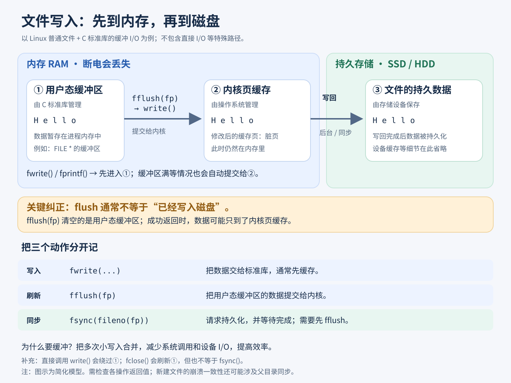

# 3.Linux


## 基本概念

 **内核**

1. 管理硬件资源(CPU，内存，外部设备)
2. 为上层应用软件提供运行环境


**系统调用**

内核对上层应用程序提供的接口


**库函数**

对系统调用进行包装，方便程序员使用


**shell**

命令解析器，可以解析命令，并执行命令或脚本(命令的集合)。


**Linux的发行版本**

发行版 = Linux内核 + 其他的支撑软件


**查看内核信息**

```shell
uname -a
```


**查看发行版本**

```shell
cat /etc/issue
```


### 用户子系统

特权用户 - `root`

普通用户 - `sudoers`，可以临时拥有特权用户的权限

普通用户 - 其他用户


**查看所有的用户**

```shell
$ cat /etc/passwd
ubuntu:x:1000:1001:Ubuntu:/home/ubuntu:/bin/bash
```

用户名|密码(废弃)|用户id|组id|comments|用户家目录|默认shell程序 


**添加用户**

```shell
sudo useradd -m -s /bin/bash test
```

-m：创建家目录

-s：指定脚本


**删除用户**

```shell
sudo userdel -r test 
```

-r：删除家目录和邮箱


**切换用户**

`su - change user ID or become superuser`

需要输入目标用户的密码

```shell
su root
```


**修改用户密码**

`passwd - change user password`

```shell
sudo passwd root
```

这里需要注意的是，sudo命令验证的是当前用户的密码，而不是root用户的密码。因此输入当前用户密码即可修改root密码。


### 文件子系统

**绝对路径**


**相对路径**


**当前工作目录**

**每个进程**都有一个属性，叫作当前工作目录

`pwd - print name of current/working directory`

显示这个shell进程的当前工作目录


#### 目录概览

`bin(binary)`：可执行程序

`dev(device)`：设备文件

`home`：普通用户的家目录

`sbin(system binary)`：和系统相关的可执行程序

`var(variable)`：经常发生变化的文件，比如日志文件

`etc`：配置文件

`lib`：库文件

`proc(process)`：进程映射文件

`usr`：系统预装软件本体、命令、库、文档

`/usr/local`：用户自己编译装的软件


#### 文件类型&权限

```shell
(base) ubuntu@VM-0-3-ubuntu:~$ ls -l
total 28
drwxrwxr-x  2 ubuntu ubuntu 4096 Sep 26 16:52 code
drwxrwxr-x  3 ubuntu ubuntu 4096 Sep 14 09:16 compilers
drwxrwxr-x  4 ubuntu ubuntu 4096 Sep 14 09:16 csapp
drwxrwxr-x  6 ubuntu ubuntu 4096 Sep  9 04:52 deep_learning
drwxrwxr-x 11 ubuntu ubuntu 4096 Sep 12 17:07 deeplearning_code
drwxrwxr-x 18 ubuntu ubuntu 4096 Sep  9 04:46 miniconda3
drwxrwxr-x  7 ubuntu ubuntu 4096 Sep  4 18:48 wedo-txjmain
```

**文件类型**

d：directory目录

-：file，普通文件

l：symbolic link，符号链接，软链接

c：字符设备(如：键盘，一个字符一个字符读取)

b：块设备(如：硬盘，一块一块读取)

p：管道文件(进程之间通信用的)

s：套接字文件(网络通信用的)


**文件权限**

```shell
drwxrwxr-x  2 ubuntu ubuntu 4096 Sep 26 16:52 
```

`rwx`：当前用户权限

`rwx`：同组其他成员权限

`r-x`：其他用户权限


## 常用命令


### 通配符

`*`：可以匹配任意多个字符

`？`：可以匹配任意一个字符

`[characters]`：匹配集合内的任意一个字符，比如`[abc](匹配abc中任意一个)`

`[!characters]`：匹配集合外的任意一个字符

**类**：

[0-9]：数字

[a-z]：小写字母

[A-Za-z]：字母


### 复制和移动 - cp&mv

#### cp

`cp` 默认是不能直接复制文件夹的，必须加 `-r`（递归）参数。但即使加了 `-r`，表现也会因目标路径的不同而完全不同：

情况 A：目标文件夹“不存在”

```shell
cp -r src_dir dest_dir
```

行为：系统会创建一个名为 `dest_dir` 的**新文件夹**，并把 `src_dir` 里的**所有内容复制进去**


情况 B：目标文件夹“已存在”

```shell
cp -r src_dir dest_dir
```

行为：系统会把 `src_dir` 整个**塞进** `dest_dir` 里面，变成 `dest_dir/src_dir`。


#### mv

`mv` 的逻辑其实跟 `cp` 非常像，它只取决于目标路径：

情况 A：目标路径不存在（重命名）

```shell
mv old_dir new_dir
```

行为：如果 `new_dir` 不存在，它会直接把 `old_dir` **改名**为 `new_dir`。表面上看是操作了整个文件夹。


情况 B：目标路径已存在（移入）

```shell
mv source_dir target_dir
```

行为：它会把 `source_dir` **整体移动到** `target_dir` 内部，变成 `target_dir/source_dir`。


### 链接 - ln

> 底层核心：Linux 文件 = **inode + 数据块** 文件名只是 inode 的一个入口（目录项）。
>
> 

**1. 硬链接（hard link）**

```
ln source target
```

- 硬链接**和原文件共享同一个 inode**。本质：给同一个文件数据，新增一个文件名。
- 多个硬链接，inode 号完全一样。
- 删除原文件：只是删掉一个目录项，**只要还有硬链接存在，文件数据不会被删除**。
- 限制：
	1. **不能跨文件系统（不能跨分区）**，inode 只在单个文件系统内有效
	2. **不能链接目录**（防止目录环，系统不允许）
- 属性：`ls -l` 看到的链接计数（第二列）会 + 1，修改任意一个硬链接，所有硬链接看到的内容一起变。
- 大小：和原文件大小相同。


**2. 软链接（symbolic link，符号链接）**

```
ln -s source target
```

- 软链接是**独立的新文件**，拥有自己独立 inode。
- 这个文件里存储的内容：**原文件的路径字符串**。
- 删除原文件：软链接本身还在，但变成**悬空链接 (dangling link)**，访问时报 No such file or directory。
- 无硬链接的限制：
	1. **可以跨分区、跨文件系统**
	2. **可以链接目录**（日常最常用）
- 属性：`ls -l` 会显示 `-> 原路径`，软链接文件大小等于原文件路径字符串长度。
- 注意：相对路径写软链接时，是**相对于软链接所在目录**，不是当前执行 ln 的目录，很容易踩坑。


**如何创建硬链接/软链接？**

带 `-s`就是创建软链接

`ln - make links between files`

`-s, --symbolic`
	`make symbolic links instead of hard links`

```shell
$ echo "hello" > 1.txt
$ cat 1.txt 
hello
$ ln -s 1.txt sym_link
$ ls -l
total 32
-rw-rw-r-- 1 ubuntu ubuntu     6 Oct 13 04:35 1.txt
lrwxrwxrwx 1 ubuntu ubuntu     5 Oct 13 04:36 sym_link -> 1.txt
$ cat sym_link 
hello
```


### 查找文件 - find

**which命令**

` which - locate a command`

**注意：**which命令只能定位一个**可执行程序**

```shell
ubuntu@VM-0-3-ubuntu:~/code$ which sshd
/usr/sbin/sshd
```


**find命令**

`find - search for files in a directory hierarchy`

**语法：**

`find 起始目录 查找条件 操作`

```shell
# -name 根据名字查找
find / -name "stdio.h"

# -a(and) -o(or) ! 组合
find linux-5.16.12/ -name "*.c" -o "*.h"

# -type 根据类型进行查找 f代表普通文件
# 查找当前文件夹下的普通文件 
find . -type f 

# -user 根据用户筛选
find /home -user watson

# -size 根据大小查找
# c for bytes
# k for KB
# M for MB
# G for GB
# 查找大于4k的
find / -size +4k
# 查找小于5M的
find / -size -5M

# -empty 查找空文件/目录
find . -empty
```


**命令的组合**

`-exec`

把一个命令的输出结果，以行为单位，当做另一个命令的参数

```shell
find /usr/include/ -name "stdio.h" -exec ls -l {} \;
```


### 权限 - chmod

`chmod - change file mode bits`


**文字设定法**

```shell
#     用户类型 操作   权限
chmod [ugoa] [+=-] [rwx]
```

u - 当前用户

g - 组

o - 其他用户

a - 所有用户


**数字设定法**

`chmod 三位8进制数字 file/dir`

```shell
chmod 777 scada
```


### 查看文件 - cat

`cat - concatenate files and print on the standard output`

**文件描述符**

| 描述符名称 | 描述符含义   | 数字枚举值 |
| ---------- | ------------ | ---------- |
| stdin      | 标准输入     | 0          |
| stdout     | 标准输出     | 1          |
| stderr     | 标准错误输出 | 2          |


**重定向**

| 重定向符号 | 含义                        | 示例                             | 解释                                                      |
| ---------- | --------------------------- | -------------------------------- | --------------------------------------------------------- |
| >          | 标准输出重定向              | `cat in.txt > out.txt`           | in.txt的内容重定向到out.txt，**文件原有内容会被清空**     |
| >>         | 标准输出重定向(追加,不覆盖) | `echo "add new line" >> out.txt` | 把正常输出追加到文件末尾，原有内容保留                    |
| <          | 标准输入重定向              | `cat < out.txt`                  | cat 默认等待键盘输入；把 out.txt 的内容当做输入传给 cat   |
| 2>         | 标准错误重定向              | `ls /dir_not_exist 2> err.txt`   | 该文件不存在，ls 产生的错误信息写到 err.txt，屏幕上没报错 |

注意：`2>`只捕获报错信息，正常输出依旧显示在屏幕


### echo

`echo - display a line of text`

```shell
# 打印test到屏幕(标准输出)
$ echo "test"
test

# 将文本写入到文件中
$ echo "hello, world" > e.txt
```


### 修改字符集 - iconv

`iconv - convert text from one character encoding to another`

​	`-f from-encoding`

​	`-t to-encoding`


**示例**

```shell
# 1.先在个人pc上编辑txt文件，里面写点中文(UTF-8编码的)
# 2.然后把文件复制到linux上，查看一下
$ cat mm.txt 
刘亦菲
古力娜扎
迪丽热巴

# 3.这时候可以正常看，现在修改一下mm.txt的字符集
$ iconv -f utf-8 -t gb2312 mm.txt

# 4.其实iconv本身不会修改原文件的编码集，因此可以重定向再看看
$ iconv -f utf-8 -t gb2312 mm.txt > MM.txt
$ cat MM.txt 
�����
��������
�����Ȱ�
```

Linux 终端（shell）默认使用 UTF-8 解码显示文本

因此，这里时候打开MM.txt(使用gb2312编码的)；你的终端是 UTF-8，拿 UTF-8 的解码器，去解析 GB2312 的字节 → 字节不匹配 → **乱码**


**注意**

1. **文件本身没有自带 “编码标记”** 文件只是一堆二进制字节。编码是**解释字节的规则**。

- mm.txt：字节是 UTF-8 规则编码出来的
- MM.txt：字节是 GB2312 规则编码出来的

2. **cat 不感知编码** cat 只管输出字节，**解码工作是终端模拟器干的**（gnome-terminal /xterm/putty）。 你看到的乱码，不是 cat 造成的，是终端用 UTF8 去读 GB2312 字节。

3. 验证：用 iconv 把 MM.txt（GB2312）转回 UTF8 就能正常看

```shell
$ iconv -f gb2312 -t utf-8 MM.txt 
刘亦菲
古力娜扎
迪丽热巴
```


### 搜索文件内容 - grep

`grep - print lines that match patterns`

​	`-E, --extended-regexp`

​	`-n, --line-number`

​	`-i, --ignore-case`

g：globally

re：regex -> regular expression

p：print


**正则表达式**

基本单位：普通字符，转义字符，任意一个字符(.)，集合([])

基本操作：

| 基本操作  | 符号  | 解释                 |
| --------- | ----- | -------------------- |
| 取反      | ^     |                      |
| 连接      |       | 基本单位是相邻的     |
| 重复      | `?`   | 重复0次或1次         |
|           | `+`   | 重复1次或多次        |
|           | `*`   | 重复任意次           |
|           | {m}   | 重复m次              |
|           | {m,n} | 重复次数在m ~ n 之间 |
|           | {,m}  | 重复次数小于等于m    |
|           | {m,}  | 重复次数大于等于m    |
| 以...开头 | `\<t` | 以t开头              |
| 以...结尾 | `e\>` | 以e结尾              |


**示例**

```shell
# 查找a.txt中包含"txt"的数据行，-n显示行号
grep -nE "txt" a.txt

# 查找a.txt中r或o出现过的数据行
grep -nE "[ro]+" a.txt

# 查找a.txt中r以及o出现过的数据行
grep -nE "(ro)+" a.txt

# 查找文本中以t开头，以e结尾的单词
grep -nE "\<t[^ ]*e\>" The_Holy_Bible.txt

# 查一个开源项目的main函数是写在哪个文件里的
# xargs - 把 | 前面的每一项当作一个参数给到后面的命令执行
find linux-5.16.12/ -name "*.c" | xargs grep -nE "int main\("
```

现在可以回头分析之前工作用的最多的一个命令：

`ps -elf | grep -nE "modbus"`

查找所有含有**modbus**字样的进程


### 打包和压缩 - tar

`tar - an archiving utility`

tar 只是打包（拼接文件 + 元数据），不是压缩！


**参数选项：**

**主选项(只能选择其中一个)：**

-c	创建

-r	追加

-x	释放


**辅选项：**

-f	指定文件名称

-v	verbose(打印过程信息)

-z	用gzip算法进行压缩/解压


**示例**

```shell
# 将所有txt文件打包
tar -cvf tarball *.txt

# 将tarball解打包
tar -xvf tarball
```

如果要进行**压缩/解压**，只需要在参数上加上`-z`，其余操作不变。


### 磁盘相关命令

`df - report file system space usage`

```shell
$ df -h
Filesystem      Size  Used Avail Use% Mounted on
tmpfs           373M  1.1M  372M   1% /run
/dev/vda2        50G   25G   23G  52% /
tmpfs           1.9G   24K  1.9G   1% /dev/shm
tmpfs           5.0M     0  5.0M   0% /run/lock
cosfs           256T     0  256T   0% /lhcos-data
tmpfs           373M   12K  373M   1% /run/user/1000
```


`du - estimate file space usage`

查看磁盘具体使用情况

```shell
$ du -h code/
28K     code/xxxx
80K     code/
```


### 远程拷贝 - scp

`scp — OpenSSH secure file copy`

`scp src dest`


**上传文件：**

```shell
# 传递单个文件
scp dmesg.txt ubuntu@106.55.32.90:/home/ubuntu/code/
# 传递整个目录
scp -r folder ubuntu@106.55.32.90:/home/ubuntu/code/
```


**下载文件：**

```shell
scp ubuntu@106.55.32.90:/home/ubuntu/code/dmesg.txt .
```

scp有个缺点：每次上传文件的时候都需要手动的验证密码。

可以用密钥对解决这个问题：

```shell
# 1.生成本地密钥对若本地已存在 ~/.ssh/id_rsa 或 ~/.ssh/id_ed25519 可跳过此步）
ssh-keygen -t ed25519

# 2.将公钥追加写入目的地的~/.ssh/authorized_keys文件里
type $env:USERPROFILE\.ssh\id_ed25519.pub | ssh ubuntu@106.55.32.90 "mkdir -p ~/.ssh && cat >> ~/.ssh/authorized_keys"

# 3.现在再上传文件就不需要验证密码了
scp .\dmesg.txt ubuntu@106.55.32.90:/home/ubuntu/code/
dmesg.txt 
```


## 系统编程


**如何学习系统编程**

权威资料：man手册

```
1   Executable programs or shell commands
2   System calls (functions provided by the kernel)
3   Library calls (functions within program libraries)
7   Miscellaneous (including macro packages and conventions), e.g. man(7), groff(7), man-pages(7)
8   System administration commands (usually only for root)
```

最重要的是2,3,7号手册。

系统调用在3号手册。


注意事项：

1. 在linux中，返回值一般不实现功能，只用来处理报错。
2. 要注意返回指针的时候，是否需要主调函数手动释放内存。


### 文件

狭义的文件：存储在**外部存储介质**(不在内存里)的数据集合

广义的文件：速度慢，容量大，可以持久存储


**文件类型**

普通文件：目录文件 软链接

字符设备文件：鼠标

块设备文件：磁盘

管道文件：程序间通信

socket：网络通信


**文件的使用**

如果在linux上使用C的库函数fopen，那么fflush之后，不代表数据已经持久化到磁盘里。




#### fopen

`NAME`
       `fopen, fdopen, freopen - stream open functions`

`LIBRARY`
       `Standard C library (libc, -lc)`

`SYNOPSIS`
       `#include <stdio.h>`

​	`FILE *fopen(const char *restrict pathname, const char *restrict mode);`


```c
# fopen的准备工作
#include <stdio.h>
#include <string.h>
#include <stdlib.h>
#define ARGS_CHECK(argc, num){if(argc!=num){fprintf(stderr, "args error!\n");return-1;}}
#define ERROR_CHECK(ret, num, msg){if(ret==num){perror(msg);return -1;}}
```

**注意：**这里要注意宏函数的预处理规则，否则可能看不懂：当预处理器看到`()`的时候，它会知道这是一个宏函数，会自动识别分割，类似宏常量的`#define N 5`，宏函数这里即使不用空格隔开，也能正确识别。

```c
int main(int argc, char *argv[]){
    ARGS_CHECK(argc,2);
    FILE *fp = fopen(argv[1],"r");
    ERROR_CHECK(fp,NULL,"fopen");
    fclose(fp);
}
```

**Q1：为什么这里要用宏函数，而不是普通函数？**

写成宏，是为了**原地展开 + 直接在外层函数 return**；普通函数做不到这个效果。


**追加模式**

追加：默认从文件结尾写入

| 模式 | 含义     | 说明                                       |
| ---- | -------- | ------------------------------------------ |
| a    | 只写追加 |                                            |
| a+   | 读写追加 | 打开时处于文件的开始，写入时跳到文件的末尾 |


**注意：**

文件里有三个指针。

一个是base指针，指向文件开头。

一个是end指针，指向文件末尾。

一个是ptr指针，每次读写自动后移。


可以使用`fseek`去重置ptr指针的位置。

`NAME`
`       fgetpos, fseek, fsetpos, ftell, rewind - reposition a stream`

```c
fseek(fp,0,SEEK_SET);
```


#### 改变文件的属性


**修改文件的权限**

`#include <sys/stat.h>`

​	`int chmod(const char *pathname, mode_t mode);`


**获取当前工作目录**

`SYNOPSIS`
       `#include <unistd.h>`

​	`char *getcwd(char *buf, size_t size);`

```c
#include <stdio.h>
#include <unistd.h>

int main(){
    char buf[1024] = {0};
    char *ret = getcwd(buf,sizeof(buf));	
    printf("ret = %p, ret = %s\n",ret,ret);
    printf("ret = %p, buf = %s\n",buf,buf);
}
```


**修改当前工作目录**

`SYNOPSIS`
       `#include <unistd.h>`

​	`int chdir(const char *path);`

```c
#include <stdio.h>
#include <unistd.h>

int main(int argc, char **argv){
    printf("before chdir, cwd = %s\n",getcwd(NULL,0));
    int ret = chdir(argv[1]);
    printf("after chdir, cwd = %s\n",getcwd(NULL,0));
}
```

注意：这里改变的是你运行的那个进程的目录，不是shell的。


**mkdir**

`SYNOPSIS`
       `#include <sys/stat.h>`

​	`int mkdir(const char *pathname, mode_t mode);`

```c
#include <stdio.h>
#include <sys/stat.h>

int main(int argc, char **argv){
    int ret = mkdir(argv[1],0777);
}
```


#### 目录流

目录在磁盘中，以链表的形式进行存储。

每一个链表结点(目录项/directory entry)，存储了孩子的基本信息。


**目录流：**

是目录文件在内存中的缓冲区。

类似于文件流，目录流也有一个指示位置的ptr指针。


**opendir**

`NAME`
       `opendir, fdopendir - open a directory`

`LIBRARY`
       `Standard C library (libc, -lc)`

`SYNOPSIS`
       `#include <sys/types.h>`
       `#include <dirent.h>`

​	`DIR *opendir(const char *name);`


**readdir**

`SYNOPSIS`
       `#include <dirent.h>`

​	`struct dirent *readdir(DIR *dirp);`


**stat**

`NAME`
       `stat, fstat, lstat, fstatat - get file status`

`LIBRARY`
       `Standard C library (libc, -lc)`

`SYNOPSIS`
       `#include <sys/stat.h>`

​	`int stat(const char *restrict pathname, struct stat *restrict statbuf);`


#### open和read


