# 3.Linux


## 基本概念

 **内核**

1. 管理硬件资源(CPU，内存，外部设备)
2. 为上层应用软件提供运行环境


**系统调用**

内核对上层应用程序提供的接口


**库函数**

对系统调用进行包装，方便程序员使用


**shell**

命令解析器，可以解析命令，并执行命令或脚本(命令的集合)。


**Linux的发行版本**

发行版 = Linux内核 + 其他的支撑软件


**查看内核信息**

```shell
uname -a
```


**查看发行版本**

```shell
cat /etc/issue
```


### 用户子系统

特权用户 - `root`

普通用户 - `sudoers`，可以临时拥有特权用户的权限

普通用户 - 其他用户


**查看所有的用户**

```shell
$ cat /etc/passwd
ubuntu:x:1000:1001:Ubuntu:/home/ubuntu:/bin/bash
```

用户名|密码(废弃)|用户id|组id|comments|用户家目录|默认shell程序 


**添加用户**

```shell
sudo useradd -m -s /bin/bash test
```

-m：创建家目录

-s：指定脚本


**删除用户**

```shell
sudo userdel -r test 
```

-r：删除家目录和邮箱


**切换用户**

`su - change user ID or become superuser`

需要输入目标用户的密码

```shell
su root
```


**修改用户密码**

`passwd - change user password`

```shell
sudo passwd root
```

这里需要注意的是，sudo命令验证的是当前用户的密码，而不是root用户的密码。因此输入当前用户密码即可修改root密码。


### 文件子系统

**绝对路径**


**相对路径**


**当前工作目录**

**每个进程**都有一个属性，叫作当前工作目录

`pwd - print name of current/working directory`

显示这个shell进程的当前工作目录


#### 目录概览

`bin(binary)`：可执行程序

`dev(device)`：设备文件

`home`：普通用户的家目录

`sbin(system binary)`：和系统相关的可执行程序

`var(variable)`：经常发生变化的文件，比如日志文件

`etc`：配置文件

`lib`：库文件

`proc(process)`：进程映射文件

`usr`：系统预装软件本体、命令、库、文档

`/usr/local`：用户自己编译装的软件


#### 文件类型&权限

```shell
(base) ubuntu@VM-0-3-ubuntu:~$ ls -l
total 28
drwxrwxr-x  2 ubuntu ubuntu 4096 Sep 26 16:52 code
drwxrwxr-x  3 ubuntu ubuntu 4096 Sep 14 09:16 compilers
drwxrwxr-x  4 ubuntu ubuntu 4096 Sep 14 09:16 csapp
drwxrwxr-x  6 ubuntu ubuntu 4096 Sep  9 04:52 deep_learning
drwxrwxr-x 11 ubuntu ubuntu 4096 Sep 12 17:07 deeplearning_code
drwxrwxr-x 18 ubuntu ubuntu 4096 Sep  9 04:46 miniconda3
drwxrwxr-x  7 ubuntu ubuntu 4096 Sep  4 18:48 wedo-txjmain
```

**文件类型**

d：directory目录

-：file，普通文件

l：symbolic link，符号链接，软链接

c：字符设备(如：键盘，一个字符一个字符读取)

b：块设备(如：硬盘，一块一块读取)

p：管道文件(进程之间通信用的)

s：套接字文件(网络通信用的)


**文件权限**

```shell
drwxrwxr-x  2 ubuntu ubuntu 4096 Sep 26 16:52 
```

`rwx`：当前用户权限

`rwx`：同组其他成员权限

`r-x`：其他用户权限


## 常用命令


### 通配符

`*`：可以匹配任意多个字符

`？`：可以匹配任意一个字符

`[characters]`：匹配集合内的任意一个字符，比如`[abc](匹配abc中任意一个)`

`[!characters]`：匹配集合外的任意一个字符

**类**：

[0-9]：数字

[a-z]：小写字母

[A-Za-z]：字母


### 复制和移动 - cp&mv

#### cp

`cp` 默认是不能直接复制文件夹的，必须加 `-r`（递归）参数。但即使加了 `-r`，表现也会因目标路径的不同而完全不同：

情况 A：目标文件夹“不存在”

```shell
cp -r src_dir dest_dir
```

行为：系统会创建一个名为 `dest_dir` 的**新文件夹**，并把 `src_dir` 里的**所有内容复制进去**


情况 B：目标文件夹“已存在”

```shell
cp -r src_dir dest_dir
```

行为：系统会把 `src_dir` 整个**塞进** `dest_dir` 里面，变成 `dest_dir/src_dir`。


#### mv

`mv` 的逻辑其实跟 `cp` 非常像，它只取决于目标路径：

情况 A：目标路径不存在（重命名）

```shell
mv old_dir new_dir
```

行为：如果 `new_dir` 不存在，它会直接把 `old_dir` **改名**为 `new_dir`。表面上看是操作了整个文件夹。


情况 B：目标路径已存在（移入）

```shell
mv source_dir target_dir
```

行为：它会把 `source_dir` **整体移动到** `target_dir` 内部，变成 `target_dir/source_dir`。


### 链接 - ln

> 底层核心：Linux 文件 = **inode + 数据块** 文件名只是 inode 的一个入口（目录项）。
>
> 

**1. 硬链接（hard link）**

```
ln source target
```

- 硬链接**和原文件共享同一个 inode**。本质：给同一个文件数据，新增一个文件名。
- 多个硬链接，inode 号完全一样。
- 删除原文件：只是删掉一个目录项，**只要还有硬链接存在，文件数据不会被删除**。
- 限制：
	1. **不能跨文件系统（不能跨分区）**，inode 只在单个文件系统内有效
	2. **不能链接目录**（防止目录环，系统不允许）
- 属性：`ls -l` 看到的链接计数（第二列）会 + 1，修改任意一个硬链接，所有硬链接看到的内容一起变。
- 大小：和原文件大小相同。


**2. 软链接（symbolic link，符号链接）**

```
ln -s source target
```

- 软链接是**独立的新文件**，拥有自己独立 inode。
- 这个文件里存储的内容：**原文件的路径字符串**。
- 删除原文件：软链接本身还在，但变成**悬空链接 (dangling link)**，访问时报 No such file or directory。
- 无硬链接的限制：
	1. **可以跨分区、跨文件系统**
	2. **可以链接目录**（日常最常用）
- 属性：`ls -l` 会显示 `-> 原路径`，软链接文件大小等于原文件路径字符串长度。
- 注意：相对路径写软链接时，是**相对于软链接所在目录**，不是当前执行 ln 的目录，很容易踩坑。


**如何创建硬链接/软链接？**

带 `-s`就是创建软链接

`ln - make links between files`

`-s, --symbolic`
	`make symbolic links instead of hard links`

```shell
$ echo "hello" > 1.txt
$ cat 1.txt 
hello
$ ln -s 1.txt sym_link
$ ls -l
total 32
-rw-rw-r-- 1 ubuntu ubuntu     6 Oct 13 04:35 1.txt
lrwxrwxrwx 1 ubuntu ubuntu     5 Oct 13 04:36 sym_link -> 1.txt
$ cat sym_link 
hello
```


### 查找文件 - find

**which命令**

` which - locate a command`

**注意：**which命令只能定位一个**可执行程序**

```shell
ubuntu@VM-0-3-ubuntu:~/code$ which sshd
/usr/sbin/sshd
```


**find命令**

`find - search for files in a directory hierarchy`

**语法：**

`find 起始目录 查找条件 操作`

```shell
# -name 根据名字查找
find / -name "stdio.h"

# -a(and) -o(or) ! 组合
find linux-5.16.12/ -name "*.c" -o "*.h"

# -type 根据类型进行查找 f代表普通文件
# 查找当前文件夹下的普通文件 
find . -type f 

# -user 根据用户筛选
find /home -user watson

# -size 根据大小查找
# c for bytes
# k for KB
# M for MB
# G for GB
# 查找大于4k的
find / -size +4k
# 查找小于5M的
find / -size -5M

# -empty 查找空文件/目录
find . -empty
```


**命令的组合**

`-exec`

把一个命令的输出结果，以行为单位，当做另一个命令的参数

```shell
find /usr/include/ -name "stdio.h" -exec ls -l {} \;
```


### 权限 - chmod

`chmod - change file mode bits`


**文字设定法**

```shell
#     用户类型 操作   权限
chmod [ugoa] [+=-] [rwx]
```

u - 当前用户

g - 组

o - 其他用户

a - 所有用户


**数字设定法**

`chmod 三位8进制数字 file/dir`

```shell
chmod 777 scada
```


### 查看文件 - cat

`cat - concatenate files and print on the standard output`

**文件描述符**

| 描述符名称 | 描述符含义   | 数字枚举值 |
| ---------- | ------------ | ---------- |
| stdin      | 标准输入     | 0          |
| stdout     | 标准输出     | 1          |
| stderr     | 标准错误输出 | 2          |


**重定向**

| 重定向符号 | 含义                        | 示例                             | 解释                                                      |
| ---------- | --------------------------- | -------------------------------- | --------------------------------------------------------- |
| >          | 标准输出重定向              | `cat in.txt > out.txt`           | in.txt的内容重定向到out.txt，**文件原有内容会被清空**     |
| >>         | 标准输出重定向(追加,不覆盖) | `echo "add new line" >> out.txt` | 把正常输出追加到文件末尾，原有内容保留                    |
| <          | 标准输入重定向              | `cat < out.txt`                  | cat 默认等待键盘输入；把 out.txt 的内容当做输入传给 cat   |
| 2>         | 标准错误重定向              | `ls /dir_not_exist 2> err.txt`   | 该文件不存在，ls 产生的错误信息写到 err.txt，屏幕上没报错 |

注意：`2>`只捕获报错信息，正常输出依旧显示在屏幕


### echo

`echo - display a line of text`

```shell
# 打印test到屏幕(标准输出)
$ echo "test"
test

# 将文本写入到文件中
$ echo "hello, world" > e.txt
```


### 修改字符集 - iconv

`iconv - convert text from one character encoding to another`

​	`-f from-encoding`

​	`-t to-encoding`


**示例**

```shell
# 1.先在个人pc上编辑txt文件，里面写点中文(UTF-8编码的)
# 2.然后把文件复制到linux上，查看一下
$ cat mm.txt 
刘亦菲
古力娜扎
迪丽热巴

# 3.这时候可以正常看，现在修改一下mm.txt的字符集
$ iconv -f utf-8 -t gb2312 mm.txt

# 4.其实iconv本身不会修改原文件的编码集，因此可以重定向再看看
$ iconv -f utf-8 -t gb2312 mm.txt > MM.txt
$ cat MM.txt 
�����
��������
�����Ȱ�
```

Linux 终端（shell）默认使用 UTF-8 解码显示文本

因此，这里时候打开MM.txt(使用gb2312编码的)；你的终端是 UTF-8，拿 UTF-8 的解码器，去解析 GB2312 的字节 → 字节不匹配 → **乱码**


**注意**

1. **文件本身没有自带 “编码标记”** 文件只是一堆二进制字节。编码是**解释字节的规则**。

- mm.txt：字节是 UTF-8 规则编码出来的
- MM.txt：字节是 GB2312 规则编码出来的

2. **cat 不感知编码** cat 只管输出字节，**解码工作是终端模拟器干的**（gnome-terminal /xterm/putty）。 你看到的乱码，不是 cat 造成的，是终端用 UTF8 去读 GB2312 字节。

3. 验证：用 iconv 把 MM.txt（GB2312）转回 UTF8 就能正常看

```shell
$ iconv -f gb2312 -t utf-8 MM.txt 
刘亦菲
古力娜扎
迪丽热巴
```


### 搜索文件内容 - grep

`grep - print lines that match patterns`

​	`-E, --extended-regexp`

​	`-n, --line-number`

​	`-i, --ignore-case`

g：globally

re：regex -> regular expression

p：print


**正则表达式**

基本单位：普通字符，转义字符，任意一个字符(.)，集合([])

基本操作：

| 基本操作  | 符号  | 解释                 |
| --------- | ----- | -------------------- |
| 取反      | ^     |                      |
| 连接      |       | 基本单位是相邻的     |
| 重复      | `?`   | 重复0次或1次         |
|           | `+`   | 重复1次或多次        |
|           | `*`   | 重复任意次           |
|           | {m}   | 重复m次              |
|           | {m,n} | 重复次数在m ~ n 之间 |
|           | {,m}  | 重复次数小于等于m    |
|           | {m,}  | 重复次数大于等于m    |
| 以...开头 | `\<t` | 以t开头              |
| 以...结尾 | `e\>` | 以e结尾              |


**示例**

```shell
# 查找a.txt中包含"txt"的数据行，-n显示行号
grep -nE "txt" a.txt

# 查找a.txt中r或o出现过的数据行
grep -nE "[ro]+" a.txt

# 查找a.txt中r以及o出现过的数据行
grep -nE "(ro)+" a.txt

# 查找文本中以t开头，以e结尾的单词
grep -nE "\<t[^ ]*e\>" The_Holy_Bible.txt

# 查一个开源项目的main函数是写在哪个文件里的
# xargs - 把 | 前面的每一项当作一个参数给到后面的命令执行
find linux-5.16.12/ -name "*.c" | xargs grep -nE "int main\("
```

现在可以回头分析之前工作用的最多的一个命令：

`ps -elf | grep -nE "modbus"`

查找所有含有**modbus**字样的进程


### 打包和压缩 - tar

`tar - an archiving utility`

tar 只是打包（拼接文件 + 元数据），不是压缩！


**参数选项：**

**主选项(只能选择其中一个)：**

-c	创建

-r	追加

-x	释放


**辅选项：**

-f	指定文件名称

-v	verbose(打印过程信息)

-z	用gzip算法进行压缩/解压


**示例**

```shell
# 将所有txt文件打包
tar -cvf tarball *.txt

# 将tarball解打包
tar -xvf tarball
```

如果要进行**压缩/解压**，只需要在参数上加上`-z`，其余操作不变。


### 磁盘相关命令

`df - report file system space usage`

```shell
$ df -h
Filesystem      Size  Used Avail Use% Mounted on
tmpfs           373M  1.1M  372M   1% /run
/dev/vda2        50G   25G   23G  52% /
tmpfs           1.9G   24K  1.9G   1% /dev/shm
tmpfs           5.0M     0  5.0M   0% /run/lock
cosfs           256T     0  256T   0% /lhcos-data
tmpfs           373M   12K  373M   1% /run/user/1000
```


`du - estimate file space usage`

查看磁盘具体使用情况

```shell
$ du -h code/
28K     code/xxxx
80K     code/
```


### 远程拷贝 - scp

`scp — OpenSSH secure file copy`

`scp src dest`


**上传文件：**

```shell
# 传递单个文件
scp dmesg.txt ubuntu@106.55.32.90:/home/ubuntu/code/
# 传递整个目录
scp -r folder ubuntu@106.55.32.90:/home/ubuntu/code/
```


**下载文件：**

```shell
scp ubuntu@106.55.32.90:/home/ubuntu/code/dmesg.txt .
```

scp有个缺点：每次上传文件的时候都需要手动的验证密码。

可以用密钥对解决这个问题：

```shell
# 1.生成本地密钥对若本地已存在 ~/.ssh/id_rsa 或 ~/.ssh/id_ed25519 可跳过此步）
ssh-keygen -t ed25519

# 2.将公钥追加写入目的地的~/.ssh/authorized_keys文件里
type $env:USERPROFILE\.ssh\id_ed25519.pub | ssh ubuntu@106.55.32.90 "mkdir -p ~/.ssh && cat >> ~/.ssh/authorized_keys"

# 3.现在再上传文件就不需要验证密码了
scp .\dmesg.txt ubuntu@106.55.32.90:/home/ubuntu/code/
dmesg.txt 
```


## 系统编程


**如何学习系统编程**

权威资料：man手册

```
1   Executable programs or shell commands
2   System calls (functions provided by the kernel)
3   Library calls (functions within program libraries)
7   Miscellaneous (including macro packages and conventions), e.g. man(7), groff(7), man-pages(7)
8   System administration commands (usually only for root)
```

最重要的是2,3,7号手册。

系统调用在3号手册。


注意事项：

1. 在linux中，返回值一般不实现功能，只用来处理报错。
2. 要注意返回指针的时候，是否需要主调函数手动释放内存。


### 文件

狭义的文件：存储在**外部存储介质**(不在内存里)的数据集合

广义的文件：速度慢，容量大，可以持久存储


**文件类型**

普通文件：目录文件 软链接

字符设备文件：鼠标

块设备文件：磁盘

管道文件：程序间通信

socket：网络通信


**文件的使用**

如果在linux上使用C的库函数fopen，那么fflush之后，不代表数据已经持久化到磁盘里。

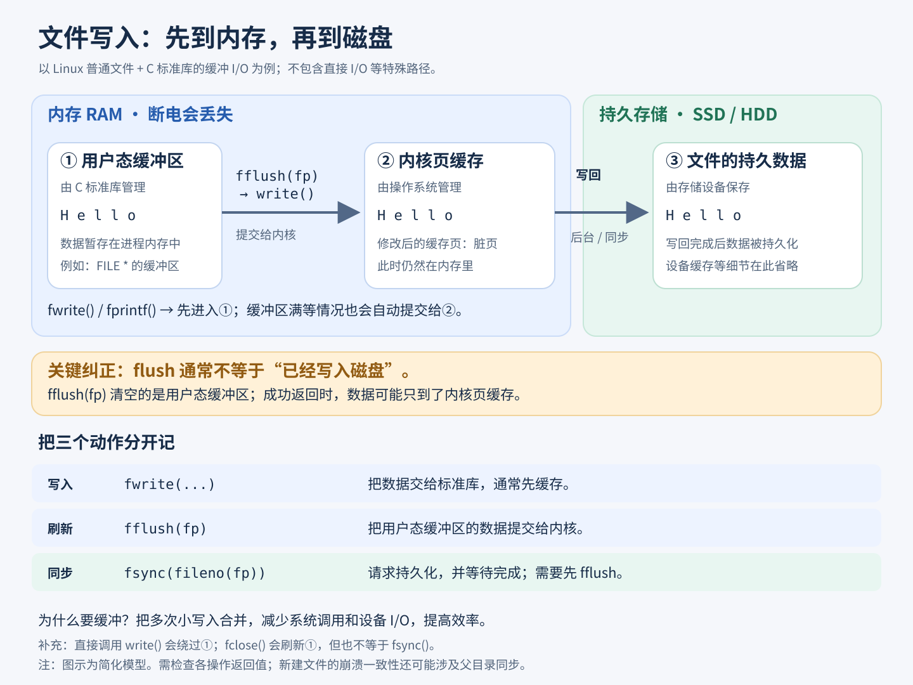


#### fopen

`NAME`
       `fopen, fdopen, freopen - stream open functions`

`LIBRARY`
       `Standard C library (libc, -lc)`

`SYNOPSIS`
       `#include <stdio.h>`

​	`FILE *fopen(const char *restrict pathname, const char *restrict mode);`


```c
# fopen的准备工作
#include <stdio.h>
#include <string.h>
#include <stdlib.h>
#define ARGS_CHECK(argc, num){if(argc!=num){fprintf(stderr, "args error!\n");return-1;}}
#define ERROR_CHECK(ret, num, msg){if(ret==num){perror(msg);return -1;}}
```

**注意：**这里要注意宏函数的预处理规则，否则可能看不懂：当预处理器看到`()`的时候，它会知道这是一个宏函数，会自动识别分割，类似宏常量的`#define N 5`，宏函数这里即使不用空格隔开，也能正确识别。

```c
int main(int argc, char *argv[]){
    ARGS_CHECK(argc,2);
    FILE *fp = fopen(argv[1],"r");
    ERROR_CHECK(fp,NULL,"fopen");
    fclose(fp);
}
```

**Q1：为什么这里要用宏函数，而不是普通函数？**

写成宏，是为了**原地展开 + 直接在外层函数 return**；普通函数做不到这个效果。


**追加模式**

追加：默认从文件结尾写入

| 模式 | 含义     | 说明                                       |
| ---- | -------- | ------------------------------------------ |
| a    | 只写追加 |                                            |
| a+   | 读写追加 | 打开时处于文件的开始，写入时跳到文件的末尾 |


**注意：**

文件里有三个指针。

一个是base指针，指向文件开头。

一个是end指针，指向文件末尾。

一个是ptr指针，每次读写自动后移。


可以使用`fseek`去重置ptr指针的位置。

`NAME`
`       fgetpos, fseek, fsetpos, ftell, rewind - reposition a stream`

```c
fseek(fp,0,SEEK_SET);
```


#### 改变文件的属性


**修改文件的权限**

`#include <sys/stat.h>`

​	`int chmod(const char *pathname, mode_t mode);`


**获取当前工作目录**

`SYNOPSIS`
       `#include <unistd.h>`

​	`char *getcwd(char *buf, size_t size);`

```c
#include <stdio.h>
#include <unistd.h>

int main(){
    char buf[1024] = {0};
    char *ret = getcwd(buf,sizeof(buf));	
    printf("ret = %p, ret = %s\n",ret,ret);
    printf("ret = %p, buf = %s\n",buf,buf);
}
```


**修改当前工作目录**

`SYNOPSIS`
       `#include <unistd.h>`

​	`int chdir(const char *path);`

```c
#include <stdio.h>
#include <unistd.h>

int main(int argc, char **argv){
    printf("before chdir, cwd = %s\n",getcwd(NULL,0));
    int ret = chdir(argv[1]);
    printf("after chdir, cwd = %s\n",getcwd(NULL,0));
}
```

注意：这里改变的是你运行的那个进程的目录，不是shell的。


**mkdir**

`SYNOPSIS`
       `#include <sys/stat.h>`

​	`int mkdir(const char *pathname, mode_t mode);`

```c
#include <stdio.h>
#include <sys/stat.h>

int main(int argc, char **argv){
    int ret = mkdir(argv[1],0777);
}
```


#### 目录流

目录在磁盘中，以链表的形式进行存储。

每一个链表结点(目录项/directory entry)，存储了孩子的基本信息。


**目录流：**

是目录文件在内存中的缓冲区。

类似于文件流，目录流也有一个指示位置的ptr指针。


**opendir**

`NAME`
       `opendir, fdopendir - open a directory`

`LIBRARY`
       `Standard C library (libc, -lc)`

`SYNOPSIS`
       `#include <sys/types.h>`
       `#include <dirent.h>`

​	`DIR *opendir(const char *name);`


**readdir**

`SYNOPSIS`
       `#include <dirent.h>`

​	`struct dirent *readdir(DIR *dirp);`


**stat**

`NAME`
       `stat, fstat, lstat, fstatat - get file status`

`LIBRARY`
       `Standard C library (libc, -lc)`

`SYNOPSIS`
       `#include <sys/stat.h>`

​	`int stat(const char *restrict pathname, struct stat *restrict statbuf);`


#### open，read，write

不带用户态缓冲区的文件IO。


**文件描述符**

文件描述符就是进程内一个整数编号，用来代表进程打开的某个内核对象（不只是普通文件），进程靠这个数字跟内核说：我要操作这个打开的东西。

> 记住：**fd 只是一个索引，不是文件本身，存在进程的文件描述符表里。**


**open**

`NAME`
       `open, openat, creat - open and possibly create a file`

`LIBRARY`
       `Standard C library (libc, -lc)`

`SYNOPSIS`
       `#include <fcntl.h>`

`int open(const char *pathname, int flags, ...
                  /* mode_t mode */ );`

成功时返回一个文件描述符，报错时返回-1。


常见flag：

| 掩码       | 含义                                                         |
| ---------- | ------------------------------------------------------------ |
| `O_RDONLY` | 以只读的方式打开                                             |
| `O_WRONLY` | 以只写的方式打开                                             |
| `O_RDWR`   | 以读写的方式打开                                             |
| `O_CREAT`  | 如果文件不存在，则创建文件                                   |
| `O_TRUNC`  | 如果文件存在，将文件的长度截至0                              |
| `O_APPEND` | 以追加的方式打开文件，每次调用write时，文件指针先移动到文件末尾 |


```c
#include <fcntl.h>
#include <stdio.h>  // printf perror
#include <unistd.h> // close
#include <stdlib.h>

int main(){
    int fd = open("zzz.txt",O_RDONLY|O_CREAT,0666);
    if(fd == -1) {
        perror("open failed");
        exit(1);
    } else{
        printf("file opened, fd = %d\n",fd);
    }
    close(fd);
}
```

`fopen`底层调用了`open`。


 **read**

`read - read from a file descriptor`

`#include <unistd.h>`

`ssize_t read(int fd, void *buf, size_t count);`

```c
// read的返回值有3种情况 
// > 0 成功读取到的字节数
// = 0 EOF
// -1 报错
char buf[10] = {0};
int count = read(fd, buf, sizeof(buf));	// 普通文件的 read，只要有数据或者到 EOF，立刻返回
```

**Q：文本文件和二进制文件的区别是什么？**

在 Linux / Unix 下：本质没有区别，磁盘上都是一串字节。所谓文本 / 二进制，是「打开方式、读写解释规则」的区别，不是文件本身的标记。Windows 才有明显差异。


**write**

`write - write to a file descriptor`

`#include <unistd.h>`

`ssize_t write(int fd, const void *buf, size_t count);`

```c
char buf[10] = "hello"；
write(fd, buf, strlen(buf));
```


**实现一个cp功能**

```c
char buf[4096] = {0};
while(1){
    if(ret == 0) break;
    memset(buf,0,sizeof(buf)); // 先清空buf
    ssize_t ret = read(fd, buf, sizeof(buf));
    write(fd, buf, ret);	// 每次读到多少就写多少
}
```

考虑性能问题：

由于read和write是系统调用，因此需要切换到内核态，来回切换状态有性能开销。

因此，buf越大越好。这样可以尽量少执行系统调用。


**ftruncate**

文件的截断：

大到小，截断末尾

小到大，末尾补0

`truncate, ftruncate - truncate a file to a specified length`

`#include <unistd.h>`

`int ftruncate(int fd, off_t length);`

```c
int ret = ftruncate(fd,20);
```


#### mmap - 内存映射

CPU可以直接读写内存里的数据，这时候内存和外设之间的数据交互，如果也需要cpu去参与，效率就较低。

**Q：**有没有一种设备，可以不需要cpu的参与，就可以完成内存与外设之间的交互？

**A：**DMA - 直接内存访问。


mmap的限制：

1. 文件大小固定(ftruncate)
2. 只能是磁盘文件
3. 建立应设之前先open


`mmap, munmap - map or unmap files or devices into memory`

```c
#include <sys/mman.h>

void *mmap(void *addr,
           size_t length, 
           int prot, 
           int flags, 
           int fd, 
           off_t offset);
```

addr：分配一片内存，填`NULL`，表示分配在堆上

length：大小固定

prot：保护选项，填`PROT_READ | PROT_WRITE`，表示可读写

flags：属性

fd：映射的文件

offset：填0

```c
int main(){
    int fd = open("test.txt",O_RDWR);
    int ret = ftruncate(fd, 5);	// 固定文件大小
    // 为内存映射分配空间
    char *p = (char*)mmap(NULL, 5, PROT_READ|PROT_WRITE, MAP_SHARED, fd, 0);
    
    // 像访问内存一样，访问文件
    for(int i = 0; i < 5; ++i){
        printf("%c",p[i]);
    }
    printf("\n");
    p[0] = 'H';		// 像写入内存一样，写入文件
    munmap(p, 5);
}
```

**✅适合场景**

1. 大文件随机访问：比如解析 10GB 的数据库 / 镜像文件，到处跳着读。
2. 只读不写的大文件：省去内核→用户态拷贝，减少 CPU 开销
3. 进程间共享内存：多个进程映射同一个文件，共享一块数据
4. 解析二进制文件（elf、图片）：把文件当成数组直接索引，非常方便


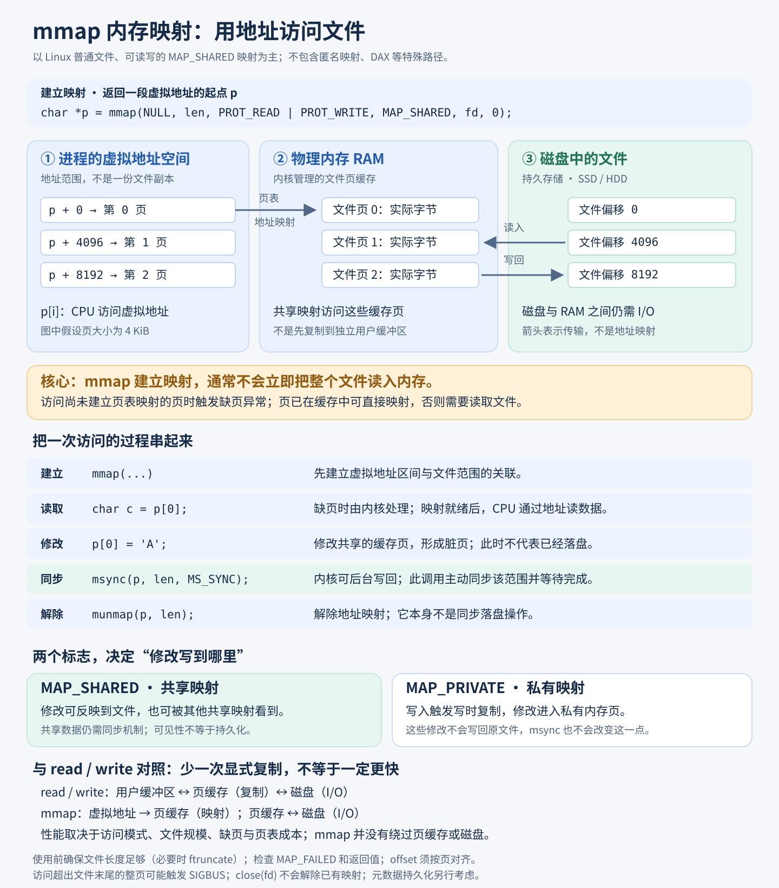


#### dup - fd的复制

文件描述符的复制：

1. fd数值上不同
2. ptr偏移量共享

`dup, dup2, dup3 - duplicate a file descriptor`

`#include <unistd.h>`

`int dup(int oldfd);`				 选取一个最小的可用fd，使旧fd和新fd指向同一个文件

`int dup2(int oldfd, int newfd);`	让new_fd与old_fd指向同一个文件对象

```c
#include <unistd.h>
#include <stdio.h>

int main(){
    int old_fd = open("1.txt",O_RDWR);
    printf("old_fd = %d\n", old_fd);
    int new_fd = dup(old_fd);	
    printf("new_fd = %d\n", new_fd);
    // 验证一下偏移是否共享
    write(old_fd,"hello",5);
    // close(old_fd); 
    write(new_fd,"hello",5);
    close(fd);
}
```

**Q：注释这里的`close`是否会影响new_fd的写入?** 

A：不会，fd这里的机制类似于C++智能指针，有一个引用计数，引用计数为0的时候才会释放。

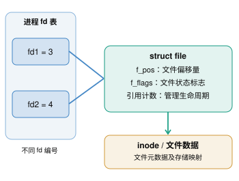


#### FIFO - 管道

是进程间通信机制在文件系统的映射。


**管道 - 命令**

`mkfifo - make FIFOs (named pipes)`

用命令创建一个管道

```shell
$ mkfifo 1.pipe
```

打开shell-1：

```shell
echo hello > 1.pipe
```

第二个shell：

```
cat 1.pipe
```


**管道 - 系统调用**

`open O_WRONLY`	写端

`open O_RDONLY`	读端


**管道之单工通信**

读端：

```c
int main(){
    int fdr = open("1.pipe", O_RDONLY);
    puts("pipe open!");
    char buf[10] = {0};
    read(fdr, buf, sizeof(buf));
    puts(buf);
    close(fdr);
}
```

写端：

```c
int main(){
    int fdw = open("1.pipe", O_WRONLY);
    puts("pipe open!");
    write(fdw, "hello", 5);
    close(fdr);
}
```

**管道是在open的时候阻塞的：**

当一个进程打开了管道一端的时候，如果对端未被打开，进程处于阻塞状态，直到对端被另一个进程打开。


**管道之双工通信**

```c
// chat1
int main(){
    int fdr = open("1.pipe",O_RDONLY);
    int fdw = open("2.pipe",O_WRONLY);
    puts("pipe open");
    char buf[4096] = {0};
    while(1){
        // 从1号管道读取消息
        memset(buf,0,sizeof(buf));
        read(fdr,buf,sizeof(buf));
        puts(buf);
        
        // 从标准输入流读取消息，并写入到2号管道
        memset(buf,0,sizeof(buf));
        read(STDIN_FILENO,buf,sizeof(buf));
        write(fdw,buf,strlen(buf));
    }
}

// chat2
int main(){
    int fdw = open("1.pipe",O_WRONLY);
    int fdr = open("2.pipe",O_RDONLY);
    puts("pipe open");
    char buf[4096] = {0};
    while(1){
        // 从标准输入流读取消息，并写入1号管道
        memset(buf,0,sizeof(buf));
        read(STDIN_FILENO,buf,sizeof(buf));
        write(fdw,buf,strlen(buf));
        
        // 从2号管道读取消息
        memset(buf,0,sizeof(buf));
        read(fdr,buf,sizeof(buf));	// !!!!如果chat1不回消息，chat2就会卡在这里阻塞
        puts(buf);
    }
}
```

这里通信有个问题，就是chat2向1号管道写完数据之后，就开始`read`2号管道，这时候如果chat1不发数据，就会导致阻塞。

这导致这2个进程之间，只能是一发一收，一发一收地进行通信。

相当于这里程序是等完`STDIN_FILENO`就绪，再等`fdr`就绪。

如果fdr一直不就绪，即使这时候`STDIN_FILENO`就绪了，程序也没有办法继续走，而是阻塞住。


**如何解决这个问题？**

IO多路复用


#### IO多路复用 - select

本质上是把之前串联地等待，变为并联的等待(一起等)。

只要有fd就绪了，程序就去进行处理。


fd_set的本质是一个位图(bit map)

```c
#include <sys/select.h>

int select(int nfds, 
           fd_set *readfds,	// 传入传出参数
		   fd_set *writefds,
		   fd_set *exceptfds,
		   struct timeval *timeout);

void FD_CLR(int fd, fd_set *set);
int  FD_ISSET(int fd, fd_set *set);	// 询问操作
void FD_SET(int fd, fd_set *set);	// 将某个fd加入监听
void FD_ZERO(fd_set *set);			// 清空
```

`fd_set`监听集合：

1. 创建`fd_set`
2. 设置合适的监听(把会引发阻塞的fd加入监听)
3. 调用select函数，会让进程阻塞，**当监听的fd中有任何一个就绪时，则select就绪**

4. 轮询所有监听的fd是否就绪


```c
// chat1
int main(){
    int fdr = open("1.pipe",O_RDONLY);
    int fdw = open("2.pipe",O_WRONLY);
    puts("pipe open");
    char buf[4096] = {0};
    fd_set rdset;
    while(1){
        FD_ZERO(&rdset);
        FD_SET(STDIN_FILENO, &rdset);
        FD_SET(fdr, &rdset);
        select(fdr+1,&rdset,NULL,NULL,NULL);
        if(FD_ISSET(fdr, &rdset)){
            puts("msg from pipe");
            memset(buf,0,sizeof(buf));
        	read(fdr,buf,sizeof(buf));
            if(read == 0) break;	// 对端关闭聊天
        	puts(buf);
        }
        if(FD_ISSET(STDIN_FILENO, &rdset)){
            puts("msg from stdin");
            memset(buf,0,sizeof(buf));
        	read(STDIN_FILENO,buf,sizeof(buf));
            if(read == 0) break;	// 我方主动关闭聊天
        	write(fdw,buf,strlen(buf));
        }
    }
}

// chat2
int main(){
    int fdw = open("1.pipe",O_WRONLY);
    int fdr = open("2.pipe",O_RDONLY);
    puts("pipe open");
    char buf[4096] = {0};
    fd_set rdset;
    while(1){
		FD_ZERO(&rdset);
        FD_SET(STDIN_FILENO, &rdset);
        FD_SET(fdr, &rdset);
        select(fdr+1,&rdset,NULL,NULL,NULL);
        if(FD_ISSET(fdr, &rdset)){
            puts("msg from pipe");
            memset(buf,0,sizeof(buf));
        	read(fdr,buf,sizeof(buf));
            if(read == 0) break;	// 对端关闭聊天
        	puts(buf);
        }
        if(FD_ISSET(STDIN_FILENO, &rdset)){
            puts("msg from stdin");
            memset(buf,0,sizeof(buf));
        	read(STDIN_FILENO,buf,sizeof(buf));
            if(read == 0) break;	// 我方主动关闭聊天
        	write(fdw,buf,strlen(buf));
        }
    }
}
```


**select的超时**

`#include <sys/time.h>`

`struct timeval {`
       `time_t       tv_sec;   /* Seconds */`
       `suseconds_t  tv_usec;  /* Microseconds */`

 `};`


```c
#include <sys/select.h>

int select(int nfds, 
           fd_set *readfds,	// 传入传出参数
		   fd_set *writefds,
		   fd_set *exceptfds,
		   struct timeval *timeout);

void FD_CLR(int fd, fd_set *set);
int  FD_ISSET(int fd, fd_set *set);	// 询问操作
void FD_SET(int fd, fd_set *set);	// 将某个fd加入监听
void FD_ZERO(fd_set *set);			// 清空
```

timeout也是传入传出参数，每次循环开始时，要设置timeout

```c
int main(){
    int fdw = open("1.pipe",O_WRONLY);
    int fdr = open("2.pipe",O_RDONLY);
    puts("pipe open");
    char buf[4096] = {0};
    fd_set rdset;
    while(1){
		FD_ZERO(&rdset);
        FD_SET(STDIN_FILENO, &rdset);
        FD_SET(fdr, &rdset);
        
        // 设置超时 2.5s
        struct timeval timeout;
        timeout.tv_sec = 2;
        timeout.tv_usec = 500000;
        int sret = select(fdr+1,&rdset,NULL,NULL,&timeout);
        if(sret == 0){
            puts("超时导致的就绪");
            continue;
        }
        if(FD_ISSET(fdr, &rdset)){
            puts("msg from pipe");
            memset(buf,0,sizeof(buf));
        	int count = read(fdr,buf,sizeof(buf));
            if(count == 0) break;	// 对端关闭聊天
        	puts(buf);
        }
        if(FD_ISSET(STDIN_FILENO, &rdset)){
            puts("msg from stdin");
            memset(buf,0,sizeof(buf));
        	int count = read(STDIN_FILENO,buf,sizeof(buf));
            if(count == 0) break;	// 我方主动关闭聊天
        	write(fdw,buf,strlen(buf));
        }
    }
}
```


**select同时监听读写**

在简单的控制台聊天或少量数据传输时，盲写通常不会卡住，因为管道/Socket 的内核发送缓冲区很大（Linux 默认管道缓冲区通常为 64KB）。

但如果遇到以下场景，**不监听“写”就会出大问题**：

1. **写缓冲区满了（避免阻塞）**： 如果对端处理很慢，或者你在短时间内发送大量数据，`fdw` 的内核缓冲区被塞满。此时你直接调用 `write()`，**整个程序就会死死卡在 `write()` 这一行代码上**，再也无法读取对端发来的消息。
2. **非阻塞 I/O（Non-blocking I/O）**： 在高性能网络编程中，Socket 通常设置为非阻塞。如果缓冲区满了，`write()` 会直接返回 `EAGAIN` 报错。此时必须把该 FD 加入 `select` 的写集合（`writefds`）中，等内核通知“缓冲区有空间了”，再去调用 `write()` 发送剩余数据。

```c
int main(){
    int fdw = open("1.pipe",O_WRONLY);
    int fdr = open("2.pipe",O_RDONLY);
    puts("pipe open");
    char buf[4096] = {0};
    fd_set rdset;
    fd_set wrset;
    int count = 0;
    while(1){
		FD_ZERO(&rdset);
        FD_SET(fdr,&rdset);
        FD_ZERO(&wrset);
        FD_SET(fdw,&wrset);
        select(fdw+1,&rdset,&wrset,NULL,NULL);
        if(FD_ISSET(fdr,&rdset)){	// 读端就绪
            printf("read count = %d",count++);
            read(fdr,buf,2048);
        }
        if(FD_ISSET(fdw,&wrset)){	// 写端就绪
            printf("write count = %d",count++);
            write(fdw,buf,4096);
        }
        sleep(1);
    }
}
```


**select的劣势**

1. 监听和就绪在一起
2. 文件数量固定(位图)
3. 大量用户态和内核态的拷贝
4. 找就绪浪费时间(轮询)


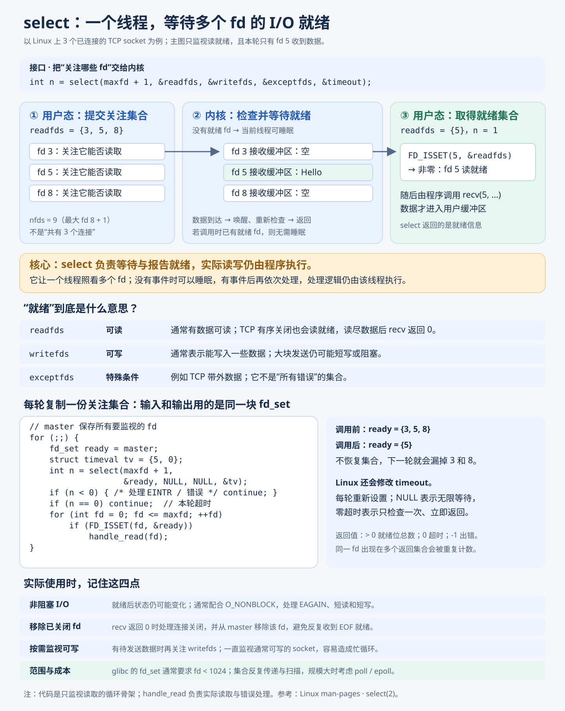


### 进程


#### **虚拟内存的原理**

一页的固定大小 = 4096字节(4KB)。

每页的固定大小为4KB，也就是2的12次方，那么用12位就可以表示业内的地址偏移。

假设我们用32位来表示内存的地址，那么前20位叫`页号`，后12位叫`页内偏移`。

由于物理内存和虚拟内存的页内偏移其实是一致的，所以虚拟内存到物理内存的映射只需要映射页号即可。

**Q1：怎么从虚拟页号得到一个物理页号？**

一个数组，用虚拟地址作为下标，每个元素用来存储页号等信息。

所以这个数组有2的20次方个元素(1MB)，假设每个元素4个字节，这样这个数组就是4MB。

每个进程需要一个独立的页表，因为不同进程的虚拟物理内存映射关系不同。

那么一个进程，就需要4MB来存储页表，怎么才能减小页表的大小？


**Q2：进程切换的代价有哪些？**

1. 切换上下文(寄存器状态(PC))
2. 切换页表

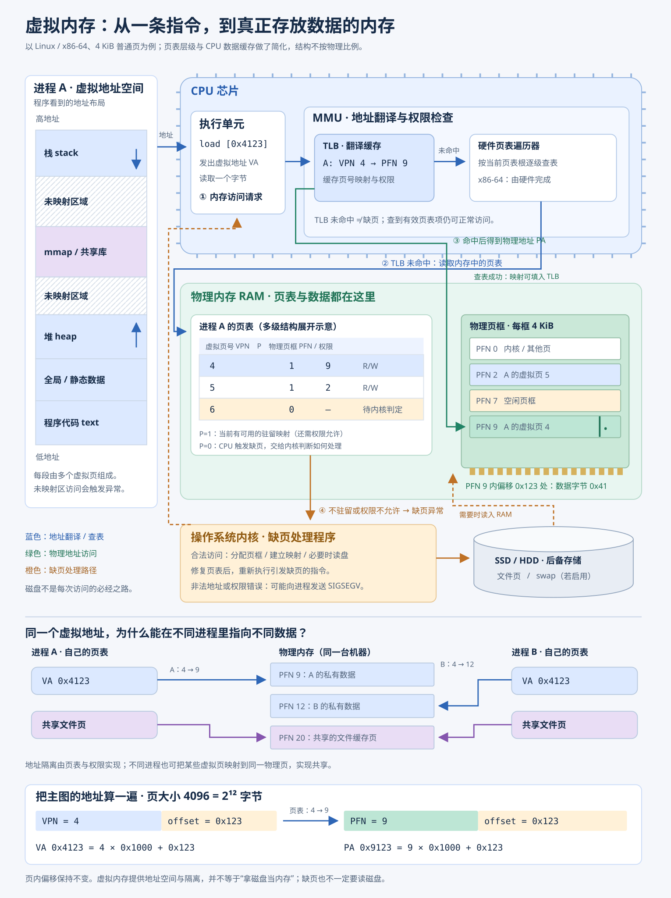


#### **进程的切换**

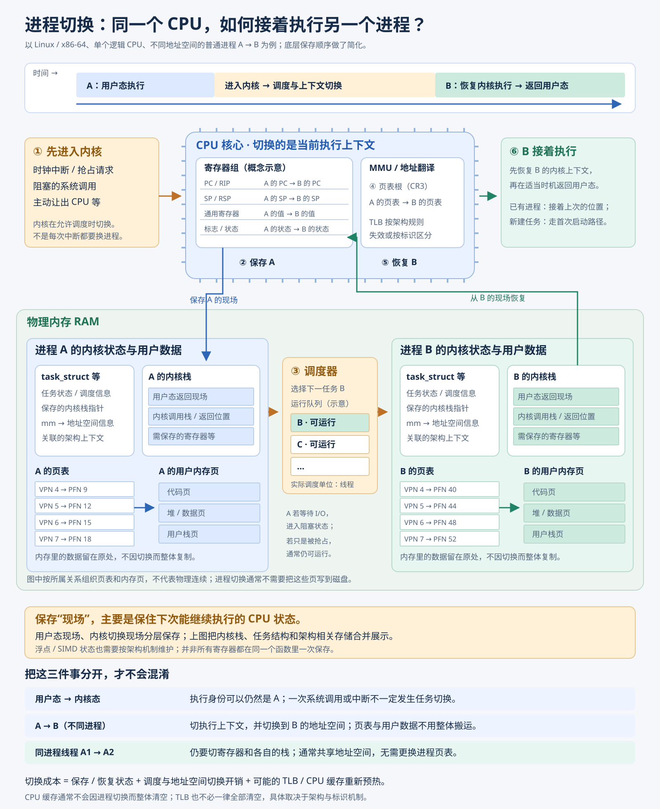


#### **pid**

pid是一个正整数，给用户去标识不同的进程。

```shell
ubuntu@VM-0-3-ubuntu:~$ ps -l
F S   UID     PID    PPID  C PRI  NI ADDR SZ WCHAN  TTY          TIME CMD
0 S  1000  358737  358735  0  80   0 -  2202 do_wai pts/0    00:00:00 bash
0 R  1000  359942  358737  0  80   0 -  2449 -      pts/0    00:00:00 ps
```

PPID：代表父进程的pid，linux所有进程都存在一种亲缘关系。


**linux系统的开机过程**

```
bootloader[bootloader] --> P0["0 ('盘古')"]
    
P0 --> P1["1 / init ('女娲')<br/>(启动所有用户进程)"]
P0 --> P2["2"]
P0 --> P0_end["0号终止"]
    
P1 --> ttys["ttys (login, shell)"]
P2 --> kernel_proc["启动所有内核进程"]
```


`getpid, getppid - get process identification`

`#include <unistd.h>`

`pid_t getpid(void);`
`pid_t getppid(void);`

```c
#include <unistd.h>
#include <stdio.h>

int main(){

        pid_t pid = getpid();
        pid_t ppid = getppid();
        printf("pid = %d\n",pid);
    	printf("ppid = %d\n",ppid);
}
```


#### 进程的权限 - getuid

**进程权限**是指一个正在运行的程序（进程）在操作系统中所拥有的**资源访问与操作能力**。

在操作系统安全模型中，**进程是发起操作的“主体”（Subject）**，而**文件/网络/硬件等是接受操作的“客体”（Object）**。

uid：真实身份

euid：有效身份(起作用的身份)


`getuid, geteuid - get user identity`

`#include <unistd.h>`

`uid_t getuid(void);`
`uid_t geteuid(void);`

```c
#include <unistd.h>

int main(){
    uid_t uid = getuid();
    uid_t euid = geteuid();
    printf("uid = %d, euid = %d\n",uid,euid);
}
```

默认情况下，一个进程的uid和euid是一样的，都是启动这个进程的用户。


#### 进程相关的命令

| 命令名  | 详细信息                          |
| ------- | --------------------------------- |
| ps      | 查看系统中的进程                  |
| top     | 动态显示系统中的进程              |
| nice    | 用于shell脚本中，指定程序的优先级 |
| renice  | 改变正在运行进程的优先级          |
| kill    | 发送信号                          |
| crontab | 控制cron后台进程                  |
| bg      | 将暂停的进程放到后台              |


##### **查看进程的两种风格**

`ps -elf`

```shell
F S UID          PID    PPID  C PRI  NI ADDR SZ WCHAN  STIME TTY          TIME CMD
1 S root           2       0  0  80   0 -     0 -      Oct22 ?        00:00:00 [kthreadd]
1 S root           3       2  0  80   0 -     0 -      Oct22 ?        00:00:00 
```

F - flag属性

S - status状态

UID - 这里实际显示的是用户的名字

PID

PPID

C - cpu占用率

PRI - 优先级

NI - 优先级

SZ - 驻留内存

WCHAN - 阻塞的系统调用

STIME - 启动时间

TTY - 终端设备

TIME - CPU占用总时间

CMD - 启动进程的命令


`ps aux`

```shell
USER         PID %CPU %MEM    VSZ   RSS TTY      STAT START   TIME COMMAND
root           2  0.0  0.0      0     0 ?        S    Oct22   0:00 [kthreadd]
root           4  0.0  0.0      0     0 ?        I<   Oct22   0:00 [kworker/R-rcu_gp]
root           5  0.0  0.0      0     0 ?        I<   Oct22   0:00 [kworker/R-sync_wq]
```

VSZ - 虚拟内存空间

RSS - 驻留集大小

STAT - status状态


##### **查看内存**

`free -h`

```shell
               total        used        free      shared  buff/cache   available
Mem:           3.6Gi       892Mi       514Mi       2.0Mi       2.5Gi       2.8Gi
Swap:          2.0Gi          0B       2.0Gi
```

**Q1：buff和cache的区别？**

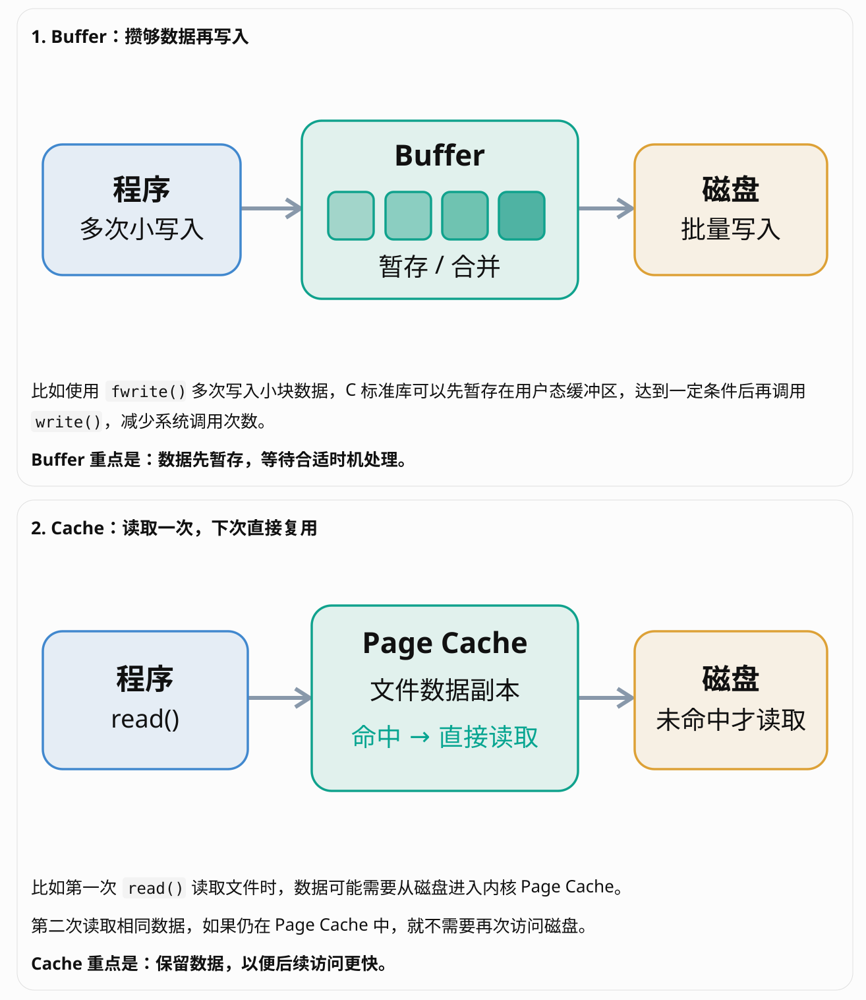


##### `top`

```shell
top - 21:21:39 up 1 day,  2:39,  2 users,  load average: 0.18, 0.12, 0.10
Tasks: 129 total,   1 running, 128 sleeping,   0 stopped,   0 zombie
%Cpu(s):  0.5 us,  0.3 sy,  0.0 ni, 99.2 id,  0.0 wa,  0.0 hi,  0.0 si,  0.0 st 
MiB Mem :   3718.7 total,    515.9 free,    890.4 used,   2573.5 buff/cache     
MiB Swap:   2048.0 total,   2048.0 free,      0.0 used.   2828.4 avail Mem 

    PID USER      PR  NI    VIRT    RES    SHR S  %CPU  %MEM     TIME+ COMMAND                                               
   7454 root      20   0  712692  25544   6432 S   0.7   0.7  13:04.33 barad_agent                                           
   7948 root      20   0 1024656  71460  36132 S   0.3   1.9   8:37.31 YDService                                             
 369951 ubuntu    20   0 1772360 121932  55436 S   0.3   3.2   0:02.56 MainThread                                            
      1 root      20   0   25720  17140  11756 S   0.0   0.5   0:07.42 systemd                                               
      2 root      20   0       0      0      0 S   0.0   0.0   0:00.03 kthreadd                                                                   
      4 root       0 -20       0      0      0 I   0.0   0.0   0:00.00 kworker/R-rcu_gp                                      
      5 root       0 -20       0      0      0 I   0.0   0.0   0:00.00 kworker/R-sync_wq
```

CPU的时间分配：

us : time running un-niced user processes

sy : time running kernel processes

ni : time running niced user processes

id : time spent in the kernel idle handler

wa : time waiting for I/O completion

hi : time spent servicing hardware interrupts

si : time spent servicing software interrupts

st : time stolen from this vm by the hypervisor


##### 优先级 - `nice/renice`

**优先级系统**

140个优先级级别，用140个整数来描述。

ubuntu系统中：-40 ~ 99来描述，数值越低，优先级别越高。

-40 ~ 59：实时优先级

 60 ~ 99：普通优先级，完全公平调度


nice：以某个nice值去启动程序

```shell
nice -n 19 ./test
```


##### 定时任务 - crontab

`crontab` 是 Linux 系统中用来设置**定时循环任务**（Cron Job）的工具。

1. **核心常用命令**

| **命令**                     | **功能描述**                                                 |
| ---------------------------- | ------------------------------------------------------------ |
| **`crontab -e`**             | 编辑当前用户的定时任务表（首次使用会提示选择编辑器，如 nano 或 vim） |
| **`crontab -l`**             | 查看当前已配置的所有定时任务列表                             |
| **`crontab -r`**             | 删除当前用户**所有的**定时任务（慎用！）                     |
| **`crontab -u username -e`** | （需 root 权限）编辑指定用户的定时任务                       |


2. **时间语法格式**

在 `crontab -e` 打开的文件中，每一行代表一条定时任务，格式固定为 **5 个时间占位符 + 1 个执行命令**：

Plaintext

```
*   *   *   *   *   command_to_execute
┬   ┬   ┬   ┬   ┬
│   │   │   │   └─── 星期几 (0 - 7，0和7均代表星期日)
│   │   │   └─────── 月份 (1 - 12)
│   │   └─────────── 日/月中天 (1 - 31)
│   └─────────────── 小时 (0 - 23)
└─────────────────── 分钟 (0 - 59)
```

特殊符号说明：

- **`\*`**：代表任意值（匹配每一个时间点）。
- **`,`**：代表枚举分割（如 `1,3,5` 代表第 1、3、5 分钟/小时）。
- **`-`**：代表范围（如 `1-5` 代表 1 到 5 点）。
- **`/\*`**：代表时间间隔/频率（如 `*/10` 代表每隔 10 个单位）。

3. **常见实战示例**

Bash

```
# 每天凌晨 02:00 清理一次日志
0 2 * * * /bin/rm -rf /tmp/logs/*

# 每周一上午 08:30 发送周报
30 8 * * 1 /home/user/send_report.sh

# 每个月 1 号的凌晨 00:00 备份数据库
0 0 1 * * /home/user/backup_db.sh

# 工作日（周一至周五）每天 09:00 到 18:00，每整点提示一次
0 9-18 * * 1-5 /home/user/notice.sh
```


#### 系统调用的原理

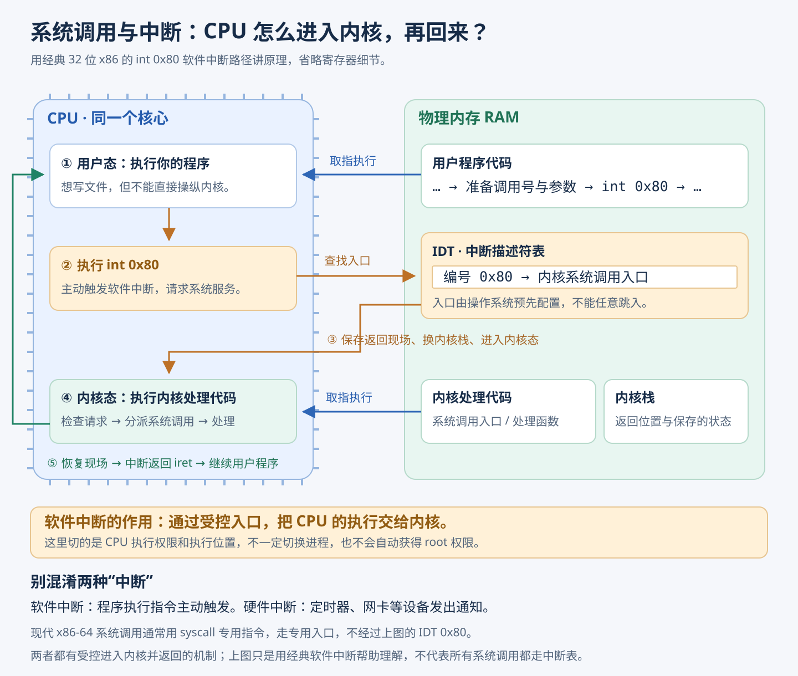


#### system和fork


在代码中启动多个进程：

`system - execute a shell command`

`#include <stdlib.h>`

`int system(const char *command);`

```c
#include <stdlib.h>
int main(){
	system("./sleep");
}
```

**system的缺点：**这个代码运行后会创建3个进程，首先是本体进程，另一个是shell，最后才是shell拉起的sleep进程。

因此，用另一个系统调用会更好：


`fork - create a child process`

`#include <unistd.h>`

`pid_t fork(void);`

父进程的`fork()`返回子进程的pid，子进程的`fork()`返回0

```c
#include <unistd.h>
#include <stdio.h>

int main(){
    pid_t pid;
    pid = fork();
    if(pid == 0){
        printf("I am child, pid = %d, ppid = %d\n",getpid(),getppid());
    } else{
        printf("I am parent, pid = %d, ppid = %d\n",getpid(),getppid());
        sleep(1);
    }
}
```

**fork的底层原理**

1. fork会拷贝一份task_struct
2. 子进程修改一些必要数据(1-2步骤之间，不可抢占)
3. 加入到就绪队列


**fork的性能 - 写时复制**

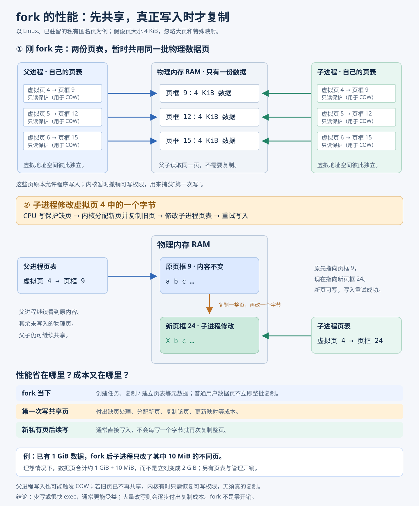


#### exec和wait

`execl, execlp, execle, execv, execvp, execvpe - execute a file`

`#include <unistd.h>`

`int execl(const char *path, const char *arg, ...
                       /*, (char *) NULL */);`

`int execv(const char *path, char *const argv[]);`

简单来说，exec的作用就是用一个新的程序替换当前正在运行的进程。

你可以把它形象地理解为"夺舍"：

1. 壳子保留：进程的PID，操作系统分配的资源，打开的文件描述符等外部身份保持不变。
2. 内存重写：原本进程里的C++代码，全局变量，堆栈全部被清空，然后把新程序的代码载入进来，从新程序的`main`函数开始执行。


**Q1：为什么fork和exec总是绑定在一起？**

因为Linux想要运行一个全新的程序，必须靠这套先分身，再变身的经典组合拳：

1. fork负责分身：复制出一个一模一样的子进程。
2. exec负责变身：在子进程里调用exec，把它变成你想运行的目标程序。


**Q2：如果不fork，直接exec会发生什么？**

你的主程序会立刻被销毁。


**代码样例：**

假设你在用C++写一个视频转码服务，需要调用系统里现成的`ffmpeg`命令行去切片HLS：

```cpp
#include <unistd.h>
#include <sys/wait.h>
#include <iostream>

void convert_video(){
  pid_t pid = fork();
  if(pid == 0){
    // 子进程内部
    execl("/usr/bin/ffmpeg","ffmpeg","-i","input.mp4","output.m3u8",NULL);
    
    // 如果execl执行成功，下面2行代码永远不会被触发
    std::cerr << "exec 失败了！" << std::endl;
    _exit(1);
  } else{
    // 父进程
    int status;
    waitpid(pid,&status,0); // 阻塞等待ffmpeg执行完毕
    std::cout << "视频转码完成" << std::endl;
  }
}
```


进程的退出：其资源由其父进程回收。

`wait, waitpid, waitid - wait for process to change state`

`#include <sys/wait.h>`

`pid_t wait(int *wstatus);`

`pid_t waitpid(pid_t pid, int *wstatus, int options);`

子进程未终止，父进程已终止：孤儿进程

子进程终止，父进程一直不调用wait：僵尸进程


#### 进程的终止

**正常退出**

`exit`

`#include <stdlib.h>`
`void exit(int status);`


`_exit`

`#include <unistd.h>`
`void _exit(int status);`

下划线版本退出前不会清空标准输出。


**主动异常终止**

`void abort();`


**另一个进程/硬件发信号终止**


#### 守护进程

**定义：**即使是`会话`关闭，进程依然可以持续运行。

以d结尾，sshd就是一个守护进程。


**进程组 - process group：**一组相关进程的集合，同一个组里共享一个**进程组ID**(PGID)。

设计它最核心的目的：方便批量发信号，比如终端一次性杀掉多个进程。

**进程组首进程 - process group leader：**这个进程的PID == PGID，它就是这个组的组长。

**会话 - session**：会话是进程组的集合。


**终端：**会话可以连接一个终端，如果终端关闭，所有会话内进程收到一个断开连接信号。

**注意：**即使是后台程序(带&后缀启动的)，会话关闭时，也会收到`SIGHUP`并跟着终端一起死亡。


**Q1：前台进程和后台进程的区别是什么？**

前台进程：占用终端的输入输出，你能看到日志，且按`Ctrl+C`能直接杀掉它

后台进程(&)：终端让出控制权，但它依然属于当前这个会话，绑在同一个控制终端上


**这也就是为什么必须有`nohup`的原因**

正因为后台进程在终端关闭时也会死，我们部署应用时才需要专门的机制来防挂：

```shell
nohup ./my_server &
```

但是它不具备任何监控和拉起功能，如果服务挂了，就是真的挂了。因此，我们还需要守护进程的机制。


**添加守护进程的方式**

**方案一：Linux系统服务控制 -- systemd**

```ini
[Unit]
Description=My Audio/Video Service

[Service]
ExecStart=/path/to/your/my_server
Restart=always           # 重点：只要挂了就自动重启
RestartSec=3             # 挂掉后等待 3 秒再拉起

[Install]
WantedBy=multi-user.target
```


**方案二：简单Shell死循环脚本(临时，轻量场景)**

```bash
#!/bin/bash
while true; do
    echo "启动服务..."
    ./my_server
    echo "服务崩溃退出，代码为 $?，3秒后自动拉起..."
    sleep 3
done
```

启动时直接后台运行这个脚本：`nohup ./run.sh &`。


**方案三：Watchdog架构代码**

```c
#include <unistd.h>
#include <sys/wait.h>
#include <iostream>

void do_real_work() {
    // 业务逻辑
}

int main() {
    while (true) {
        pid_t pid = fork();

        if (pid == 0) {
            // 子进程：负责跑核心业务逻辑
            do_real_work();
            return 0; 
        } else if (pid > 0) {
            // 父进程（Watchdog 守护进程）：阻塞等待子进程退出
            int status;
            waitpid(pid, &status, 0); 
            
            // 如果走到这里，说明子进程挂掉了（比如 Crash 了）
            std::cout << "警告：工作子进程挂掉，准备重启..." << std::endl;
            sleep(1); // 防止疯狂连续崩溃占用 100% CPU
        }
    }
    return 0;
}
```


#### 进程间通信 - IPC

打破进程之间的隔离，让进程间可以共享数据。

- 管道
- 共享内存
- 信号量
- 消息队列
- 信号


有名管道：在文件系统存在一个管道文件

匿名管道：文件系统中不存在，只用于父子进程间


##### 管道

`popen, pclose - pipe stream to or from a process`

`#include <stdio.h>`

`FILE *popen(const char *command, const char *type);`

`int pclose(FILE *stream);`

父子进程之间通过**管道**连在一起，管道的两端都是文件流。

**`command`**：需要执行的 Shell 命令字符串（支持管道 `|`、重定向 `< >` 等 Shell 语法）。

**`type`**：

- `"r"`：**读模式**。父进程可以通过返回的 `FILE*` 读取子进程命令产生的输出数据（标准输出）。
- `"w"`：**写模式**。父进程可以通过返回的 `FILE*` 向子进程的标准输入写入数据。

**返回值**：成功返回标准文件流指针 `FILE*`，失败返回 `NULL`。

**`pclose()`**：用于关闭管道流。它会阻塞等待子进程结束，并返回 Shell 命令的退出状态码（可通过 `WEXITSTATUS()` 等宏解析）。


读模式：

```c
#include <stdio.h>

// 父进程
int main(){
    FILE *fp = popen("./print","r");	// print程序，负责向标准输出流写入数据
    char buf[1024] = {0};
    fread(buf,1,sizeof(buf),fp);
    printf("msg from pipe, buf = %s\n", buf);
}

// print.c
int main(){
  printf("I am print, writing to stdout\n");
}
```


写模式：

```c
#include <stdio.h>

// 父进程
int main(){
    FILE *fp = popen("./sub","w");	
    fwrite("1000 999",1,8,fp);
}

// sub.c
int main(){
  int lhs, rhs;
  scanf("%d%d", &lhs, &rhs);
  printf("lhs - rhs = %d\n", lhs-rhs);
}
```


`NAME`
       `pipe, pipe2 - create pipe`

​	`#include <unistd.h>`

​	`int pipe(int pipefd[2]);` 

参数应该是一个长度为2的int数组数组名，第一个元素是读，第二个元素是写

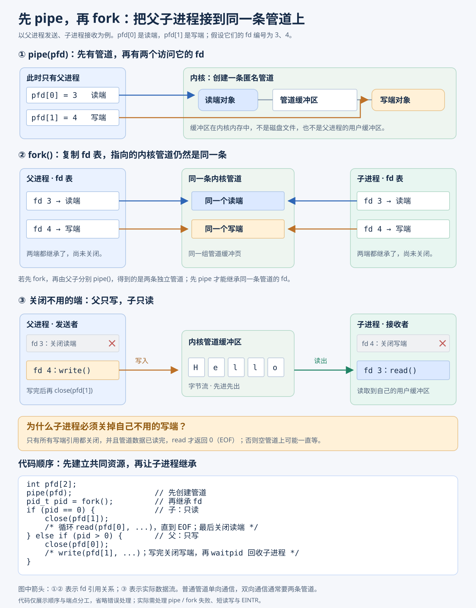

只有有父子关系的进程之间才能用无名管道进行通信。


**有名管道的函数**

 `int mkfifo(const char *path, mode_t mode);` 创建有名管道

`int unlink(const char *path);` 删除文件

`int rename(const char *oldpath, const char *newpath);` mv文件

`int link(const char *oldpath, const char *newpath);` 建立硬链接


##### 共享内存

效率最高的IPC。

将不同进程的虚拟内存页映射到同一个物理页/页框。


##### 消息队列

IPC的消息队列：只能在本机通信

广义的消息队列：网络通信，如kafka


##### 信号

一种软件层面的异步事件机制。

**中断：**硬件层面


不同的信号用不同的整数标识

`kill -l`命令可以查询不同信号名称对应的整数数值


**信号的默认行为**

| 信号名称 | 默认行为                                                     |
| -------- | ------------------------------------------------------------ |
| Term     | Default action is to terminate the process.                  |
| Ign      | Default action is to ignore the signal.                      |
| Core     | Default action is to terminate the process and dump core (see core(5)). |
| Stop     | Default action is to stop the process.                       |
| Cont     | Default action is to continue the process if it is currently stopped. |


**当信号产生时**

信号产生时会修改目标进程的`task_struct`。

从目标进程的视角中，可以认为是所有的信号都来自于内核。


**signal函数**：注册信号处理行为，当信号到来时，才会调用这个函数。

`SYNOPSIS`
       `#include <signal.h>`

​	`typedef typeof(void (int))  *sighandler_t;`

​	`sighandler_t signal(int signum, sighandler_t handler);`

返回值是一个函数指针。

参数1：int类型

参数2：函数指针


**信号递送的行为**

```c
#include <signal.h>
#include <stdio.h>
#include <unistd.h>

void sig_func(int num){
    printf("num = %d\n",num);
    printf("before sleep, I am %d\n",num);
    sleep(3);
    printf("after sleep, I am %d\n",num);
}

int main(){
    void (*ret)(int);
    ret = signal(SIGINT,sig_func);
    while(1){

    }
}
```

shell执行：

```shell
ubuntu@VM-0-3-ubuntu:~/code$ ./a.out 
^Cnum = 2
before sleep, I am 2
^C^C^C^Cafter sleep, I am 2
num = 2
before sleep, I am 2
after sleep, I am 2
```

**Q1：为什么这里一共按了5次`Ctrl+C`，但实际只递送了2次信号？**

第一次信号递送执行中，由于sleep了3秒，在这期间第二次信号就来了，这时候会发生`阻塞`，让产生的信号不能马上`递送`，而是处于`未决`状态。(未决：已产生，但未递送的信号)

由于mask和pending状态的数据结构是位图，所以只能存储2种状态，如果在未决状态下，再次产生信号，会丢失


**Q2：不同信号的阻塞会怎么样？**

当信号在递送的过程中，会把自己加入到mask里面。

类似于一个栈结构，比如2号信号阻塞的时候，产生了一个3号信号，会先执行3号信号，等3号信号递送完毕后，再处理2号信号。


**低速系统调用**

可能陷入永久等待的系统调用。

signal会自动重启低速系统调用。


**`sigaction`函数**

`sigaction, rt_sigaction - examine and change a signal action`

```c
#include <signal.h>

int sigaction(int signum, const struct sigaction *act, struct sigaction *oldact);

// sigaction结构体
struct sigaction {
	void     (*sa_handler)(int);							// 2选1，递送行为，对应sig_func
	void     (*sa_sigaction)(int, siginfo_t *, void *);		// ↑
	sigset_t   sa_mask;		// 额外mask
	int        sa_flags;	// 属性
	void     (*sa_restorer)(void); // 没用的
};
```

**sigaction的属性**

sigaction不默认重启低速系统调用：

```c
#include <signal.h>
#include <stdio.h>
#include <unistd.h>
#include <memory.h>

void sig_func(int num){
    printf("num = %d\n",num);
}

int main(){
    struct sigaction act;
    memset(&act,0,sizeof(act));
    act.sa_handler = sig_func;
    int ret = sigaction(SIGINT,&act,NULL);
    
    char buf[100] = {0};
    read(STDIN_FILENO,buf,sizeof(buf));
    printf("buf = %s\n",buf);
}

-------------------shell-------------------------
ubuntu@VM-0-3-ubuntu:~/code$ ./sigaction 
^Cnum = 2
buf = 
ubuntu@VM-0-3-ubuntu:~/code$ 
```


可以调整属性，让sigaction重启低速系统调用：

```c
#include <signal.h>
#include <stdio.h>
#include <unistd.h>
#include <memory.h>

void sig_func(int num){
    printf("num = %d\n",num);
}

int main(){
    struct sigaction act;
    memset(&act,0,sizeof(act));
    act.sa_handler = sig_func;
    act.sa_flags = SA_RESTART;
    int ret = sigaction(SIGINT,&act,NULL);
    
    char buf[100] = {0};
    read(STDIN_FILENO,buf,sizeof(buf));
    printf("buf = %s\n",buf);
}

-------------------shell-------------------------
ubuntu@VM-0-3-ubuntu:~/code$ ./sigaction 
^Cnum = 2
zzz
buf = zzz

ubuntu@VM-0-3-ubuntu:~/code$ 
```


**时钟函数**

`alarm - set an alarm clock for delivery of a signal`

`#include <unistd.h>`

`unsigned int alarm(unsigned int seconds);`


### 线程


#### **创建线程**

一启动进程，就创建了主线程，栈区从`main`开始压栈。

`pthread_create - create a new thread`

```c
#include <pthread.h>
int pthread_create(pthread_t *thread,				// PID
const pthread_attr_t *attr,							// 线程属性
typeof(void *(void *_Nullable)) *start_routine,		// 线程启动函数的函数指针
void *arg);											// start_routine的参数
```


**获取本线程的线程ID**

`pthread_self - obtain ID of the calling thread`

`#include <pthread.h>`

`pthread_t pthread_self(void);`

```c
#include <pthread.h>
#include <stdio.h>
#include <unistd.h>

void *thread_func(void *arg){
    printf("I am child thread, tid = %lu\n", pthread_self());
}

int main(){
    printf("I am main thread, tid = %lu\n", pthread_self());
    pthread_t tid;
    pthread_create(&tid,NULL,thread_func,NULL);
    sleep(1);
    return 0;
}   
```

如果主线程终止，整个进程终止


**多线程禁用perror**

由于perror不是线程安全的，因此多线程场景下应该用`strerror+fprintf`。

```c
#include <pthread.h>
#include <stdio.h>
#include <unistd.h>
#include <string.h>

void *thread_func(void *arg){
    printf("I am child thread, tid = %lu\n", pthread_self());
    while(1){
        sleep(1);
    }
}

int main(){
    pthread_t tid;
    for(int i=0;;++i){	// 看看一个进程到底能创建多少个线程
        int ret = pthread_create(&tid,NULL,thread_func,NULL);
        if(ret!=0){
            fprintf(stderr,"%s:%s\n", "error:", strerror(ret));
            printf("i = %d\n",i);
            break;
        }
    }
    
    return 0;
}   
```


#### **线程的终止**

一个进程的任一线程：

1. main return
2. exit
3. abort
4. 收到信号

整个进程终止，其中的所有线程也终止了。


**Q1：子线程如何只终止自己呢？**

从任何位置调用`pthread_exit`


**pthread_join**

`pthread_join - join with a terminated thread`

```c
#include <pthread.h>

int pthread_join(pthread_t thread, void **retval);
//                目标线程的PID
```


等待任何一个线程的终止：

```c
void *thread_func(void *arg){
    printf("I am child thread, tid = %lu\n", pthread_self());
    pthread_exit((void*)23456);
}

int main(){
    pthread_t tid;
    int ret = pthread_create(&tid,NULL,thread_func,NULL);
    pthread_join(tid,NULL); // 不获取子线程的终止状态，阻塞线程直到tid线程终止
}   
```


#### 线程的取消

`pthread_cancel - send a cancelation request to a thread`

`#include <pthread.h>`

`int pthread_cancel(pthread_t thread);`

向一个线程发送取消请求，该线程将运行至某个取消点(cancellation point)时终止。

比如说下面这个例子，主线程向子线程发送取消请求，但因为子线程没有运行到取消点，导致线程的取消不成功，解决方法是手动增加取消点。

```c
#include <pthread.h>
#include <stdio.h>
#include <unistd.h>
#include <string.h>

void *thread_func(void *arg){
    //printf("I am child thread, tid = %lu\n", pthread_self());
    while(1){
        pthread_testcancel(); // 手动增加取消点
    }
    pthread_exit((void*)0);
}

int main(){
    pthread_t tid;
    int ret = pthread_create(&tid,NULL,thread_func,NULL);
    pthread_cancel(tid);
    void *retval;
    pthread_join(tid,&retval); // 如果tid是被cancel掉的，retval就是-1
    printf("child thread return value = %ld\n",(long)retval);
}   
```

cancel不是立刻终止一个线程：

1. cancel会立刻修改目标线程的**取消标志位**
2. 目标线程运行到一些特殊的函数(取消点)
3. 运行线程终止清理函数(资源清理栈)
4. 取消点函数调用完成前/后会终止线程


#### 互斥锁 - mutex

一个线程可以做加锁操作：

1. 若未加锁，加锁操作将加锁，线程继续运行

2. 若已有任何线程持有锁，加锁的线程会阻塞

```c
// 动态初始化
int pthread_mutex_init(pthread_mutex_t *mutex, const pthread_mutexattr_t *mutexattr);

// 加锁
int pthread_mutex_lock(pthread_mutex_t *mutex);

// 非阻塞加锁
int pthread_mutex_trylock(pthread_mutex_t *mutex);

// 解锁
int pthread_mutex_unlock(pthread_mutex_t *mutex);

// 销毁锁
int pthread_mutex_destroy(pthread_mutex_t *mutex);
```


使用互斥锁保护资源：

```c
#include <pthread.h>
#include <stdio.h>
#define NUM 10000000

typedef struct shared_res{
    pthread_mutex_t mutex;
    int count;
}shared_res_t;

void *thread_func(void *arg){
    shared_res_t *pSharedRes = (shared_res_t*)arg;
    for(int i = 0;i < NUM; ++i){
        // ----------临界区-----------------------
        // 所有共享资源的访问要放入临界区
        pthread_mutex_lock(&pSharedRes->mutex);
        ++pSharedRes->count;
        pthread_mutex_unlock(&pSharedRes->mutex);
        // ----------临界区-----------------------
    }
}

int main(){
    shared_res_t share_res;
    share_res.count = 0;
    pthread_mutex_init(&share_res.mutex,NULL); // 以默认形式初始化锁
    pthread_t tid;
    int ret = pthread_create(&tid,NULL,thread_func,(void*)&share_res);
    for(int i = 0;i < NUM; ++i){
        // ----------临界区-----------------------
        // 所有共享资源的访问要放入临界区
        pthread_mutex_lock(&share_res.mutex);
        ++share_res.count;
        pthread_mutex_unlock(&share_res.mutex);
        // ----------临界区-----------------------
    }
    pthread_join(tid,NULL);
    printf("count = %d\n",share_res.count);
    pthread_mutex_destroy(&share_res.mutex);
}
```


#### **死锁**

线程阻塞，等待永远不可能为真的条件成立。


**死锁的种类**

1. 申请资源的顺序有问题，比如两根管道的建立
2. 持有锁的线程终止了
3. 一个线程对同一把锁加锁两次

```c
#include <pthread.h>
#include <stdio.h>

int main(){
    pthread_mutex_t mutex;
    pthread_mutex_init(&mutex,NULL);
    pthread_mutex_lock(&mutex);
    puts("lock first time");
    pthread_mutex_lock(&mutex);
    puts("lock second time");
    pthread_mutex_destroy(&mutex);
}

----------------------------------------
ubuntu@VM-0-3-ubuntu:~/code$ gcc deadlock.c -o dlock
ubuntu@VM-0-3-ubuntu:~/code$ ./dlock 
lock first time
```


#### 条件变量

实现事件的同步。提供了一种**无竞争**的事件会和场景。

条件变量必须配合锁一起使用。


条件变量的实现过程：

1. 设计一个条件，这个条件决定了本线程是否需要等待。
2. 如果不满足，调用wait会使本线程陷入等待。
3. 等待期间，另外的线程会运行(占用cpu)，直到将条件改成满足，通知/唤醒(signal)阻塞的线程恢复就绪。


**条件变量的接口**

```c
#include <pthread.h>

// 创建
pthread_cond_t cond = PTHREAD_COND_INITIALIZER;
int pthread_cond_init(pthread_cond_t *cond, pthread_condattr_t *cond_attr);

// 唤醒
int pthread_cond_signal(pthread_cond_t *cond);

int pthread_cond_broadcast(pthread_cond_t *cond);

// 等待
int pthread_cond_wait(pthread_cond_t *cond, pthread_mutex_t *mutex);

int pthread_cond_timedwait(pthread_cond_t *cond, pthread_mutex_t *mutex, const struct timespec *abstime);

// 销毁
int pthread_cond_destroy(pthread_cond_t *cond);
```


条件变量的一般流程：

```c
#include <pthread.h>
#include <stdio.h>
#include <unistd.h>

typedef struct shareRes_s{
    int flag;
    pthread_cond_t cond;
    pthread_mutex_t mutex;
} shareRes_t;

void * threadFunc(void *arg){
    shareRes_t *pShareRes = (shareRes_t*)arg;
    pthread_mutex_lock(&pShareRes->mutex);
    // 只有在加了锁的状态下，才能使用wait。因为我们希望检查状态和陷入等待是一个原子操作
    if(pShareRes->flag == 0){
        pthread_cond_wait(&pShareRes->cond,&pShareRes->mutex);
    }
    puts("world");
    pthread_mutex_unlock(&pShareRes->mutex);
    pthread_exit(NULL);
}

int main(){
    // 初始化锁和条件变量
    shareRes_t shareRes;
    pthread_mutex_init(&shareRes.mutex,NULL);
    pthread_cond_init(&shareRes.cond,NULL);
    shareRes.flag = 0;

    // 创建一个子线程
    pthread_t tid;
    pthread_create(&tid,NULL,threadFunc,(void*)&shareRes);

    //sleep(1);
    // 先执行一个事件，然后唤醒等待在条件变量上的某个线程
    puts("Hello");
    shareRes.flag = 1;
    pthread_cond_signal(&shareRes.cond); 

    // 等待子线程的终止 + 收尾
    pthread_join(tid,NULL);
    pthread_cond_destroy(&shareRes.cond);
    pthread_mutex_destroy(&shareRes.mutex);
}
```


**pthread_cond_wait的实现**

1. 判断有没有加锁
2. 把自己加入唤醒队列
3. 解锁并陷入阻塞
4. 收到signal之后，使自己处于就绪状态
5. 加锁
6. 持有锁之后再继续运行


#### 线程安全

有些库函数的诞生比操作多线程还早，在多线程的情况下，运行可能不正确。


下面这个例子通过对比不可重入函数 `ctime()` 和可重入（线程安全）函数 `ctime_r()`，展示了**如何通过将缓冲区所有权交由主调函数（调用方）分配，来解决多线程共享静态变量导致的数据竞争问题**。


**1.线程不安全版本（使用 `ctime`）**

在这个版本中，`ctime()` 内部使用的是静态全局缓冲区。当主线程修改时间后，子线程再次读取 `p` 时，内容会被覆盖错乱。

```c
#include <stdio.h>
#include <time.h>
#include <pthread.h>
#include <unistd.h>

void *threadFunc(void *arg) {
    time_t now = time(NULL);
    char *p = ctime(&now); 
    printf("child (第一次打印): %s", p);
    sleep(5);
    printf("child (第二次打印，已被覆盖): %s", p);
}

int main() {
    pthread_t tid;
    pthread_create(&tid, NULL, threadFunc, NULL); 
    sleep(2); 
    time_t mainNow = time(NULL);
    char *p = ctime(&mainNow); 
    printf("main : %s", p);
    pthread_join(tid, NULL);
}
```

**运行现象：** 子线程第二次打印的时间字符串，会变得跟主线程打印的时间一模一样（即子线程原本的时间数据丢失了）。


**2.线程安全版本（使用 `ctime_r`）**

在这个版本中，主线程和子线程各自在自己的栈上分配内存（`buf`），并作为参数传递给 `ctime_r`，各自独立，互不影响。

```c
#include <stdio.h>
#include <time.h>
#include <pthread.h>
#include <unistd.h>

void *threadFunc(void *arg) {
    time_t now = time(NULL);
    char buf[1024] = {0}; // 在子线程栈上分配缓冲区
    char *p = ctime_r(&now, buf); 
    printf("child (第一次打印): %s", p);
    sleep(5);
    printf("child (第二次打印，未受影响): %s", p); 
    return NULL;
}

int main() {
    pthread_t tid;
    pthread_create(&tid, NULL, threadFunc, NULL);
    sleep(2);
    time_t mainNow = time(NULL);
    char buf[1024] = {0}; // 在主线程栈上分配自己的缓冲区
    // 主线程使用自己独立的 buf
    char *p = ctime_r(&mainNow, buf); 
    printf("main : %s", p);
    pthread_join(tid, NULL);
    return 0;
}
```


**可重入和不可重入**

一个函数在调用过程，有机会再次调用自己，同步的形式就叫递归，异步的形式就叫重入，比如说多线程或信号。

如果一个函数在重入后的结果和不重入的结果一样，就叫可重入函数。

可重入函数：

1. 不加锁，则不访问共享区域
2. 不修改代码段
3. 不调用不可重入函数


### 网络


#### 基础概念

**如何定位一个主机？**

IP地址

**如何定位一个进程？**

端口号


##### **MAC地址**

物理地址，比如`ether 52:54:00:8c:90:1b`，48位 = 6字节的数据

以太网帧的一般格式：RFC-894

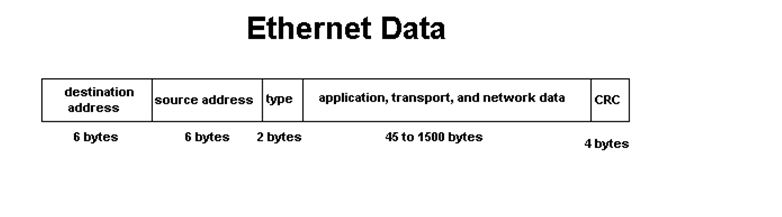

这里的地址都是MAC地址，6字节。


##### **ARP协议**

ARP（Address Resolution Protocol，地址解析协议）

根据目标 **IP 地址**，拿到对应的 **MAC 地址**，工作在数据链路层和网络层之间。

流程举例：

1. 主机 A 想发给 192.168.1.10（同网段）
2. A 查自己的 ARP 缓存表，看有没有这个 IP 对应的 MAC
3. 没有 → 发 **ARP 广播请求**：“谁是 192.168.1.10？请把你的 MAC 告诉我”
4. 局域网里所有主机都收到广播，只有 IP 匹配的主机 B 回复 **ARP 单播应答**，带上自己 MAC
5. A 收到应答，把 <IP → MAC> 存入 ARP 缓存，之后就可以构造以太网帧正常通信


##### IP协议

IP 协议（Internet Protocol，网际协议）

负责跨网络把数据包送到目标 IP，做寻址、路由、分片，工作在网络层（三层）。


**Ipv4数据报格式**

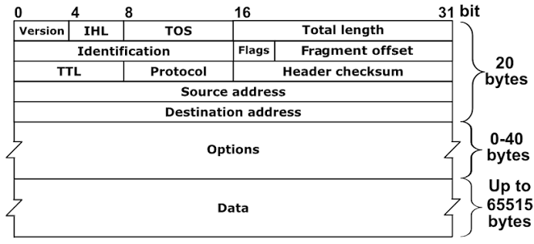

Total Length总长度：16比特，2字节，也就是最长是65535个字节。

Identification标识：同一个原始包的不同分片，标识是同一个。

Flags+offset：用于标识分片和片偏移。

TTL：存活时间。为了避免一个旧包在网络中无限循环。

Protocol：协议，描述上层协议的类型，最常见的ICMP，UDP，TCP

这里对比以太网帧的MTU是1500字节， 说明一个以太网帧放不下一个IPv4数据报，因此这里需要**分片和重组**。


**分片和重组**

链路有 MTU（最大帧长度），如果 IP 包太大超过 MTU，IP 会把包切成小片；

每一个分片是一个单独的IP数据报，有自己单独的IP头部。

到达目标主机后，再重新拼回完整数据包。


##### **NAT技术**

把内网私有 IP，转换成公网 IP，实现多台内网设备共用一个公网 IP 上网，一般在路由器上实现。

核心原理：

1. 内网主机 `192.168.1.100:5000` 发起访问外网 `223.5.5.5:80`
2. 路由器收到包，记下这条映射：`(内网IP+端口) ↔ (公网IP+临时端口)`
3. 把源 IP 改成路由器的公网 IP，源端口换成路由器自己一个空闲端口，发出去
4. 外网服务器回复包，目标是【公网 IP + 那个临时端口】
5. 路由器查表，根据端口找到对应的内网主机，改回内网 IP 和原始端口，转发回去


**路由器的原理**

路由器工作在L3。

根据包的目的IP地址，做转发操作。

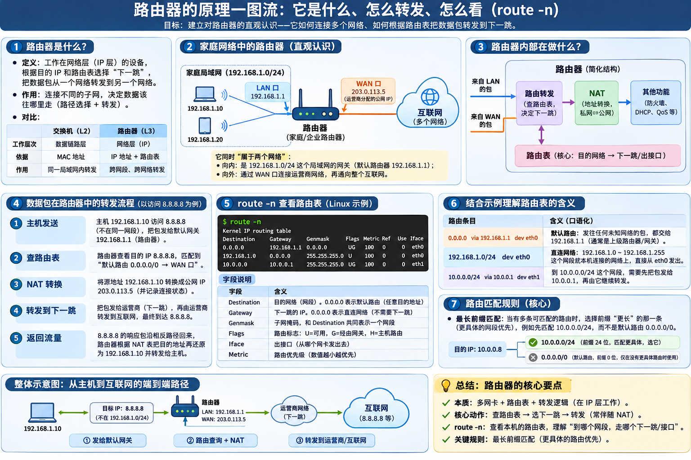


##### TCP

面向连接的协议，可靠，全双工，端到端(不支持广播和组播)


**Q1：TCP怎么保证可靠性？**

1. 确认机制ACK
2. 缓冲区保存已发送未确认的数据
3. 定时器，超时重传
4. 为了避免接收方收到重复的包，需要带上序号


**Q2：TCP怎么限制速度？**

限制已发送未确认的包的数量 - 滑动窗口机制


**TCP3次握手**

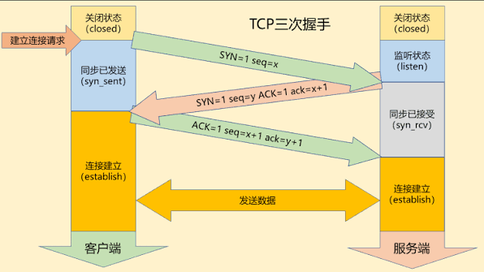

同步双方的序列号（ISN），并且确认双方收发能力都正常，建立可靠的连接状态。

TCP 是面向连接、可靠传输，核心依靠**序列号 + ACK 确认号**。序列号是每一方自己独立生成的初始序号 ISN，双方都要把自己的 ISN 告诉对方，还要确认收到对方的 ISN。


**TCP4次挥手**

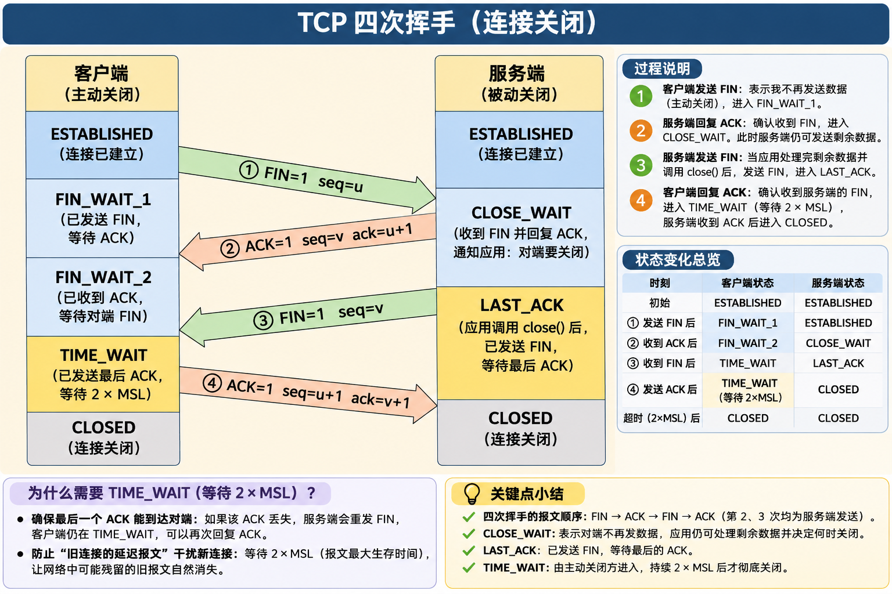


**TCP段的头部**


##### UDP

不可靠，无连接，消息有边界

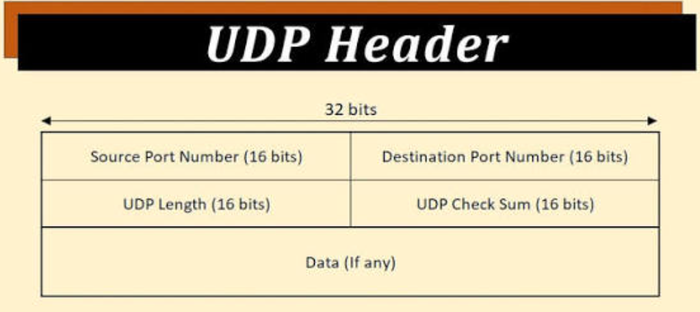


##### 字节序

大端法：高位低地址，低位高地址

小端法：高位高地址，低位低地址

**大端**法也叫**网络字节序**


**大小端转换**

```c
#include <arpa/inet.h>

// 从主机字节序(小端)转到网络字节序(大端)
uint32_t htonl(uint32_t hostlong);
uint16_t htons(uint16_t hostshort);

uint32_t ntohl(uint32_t netlong);
uint16_t ntohs(uint16_t netshort);
```

h：host，主机

n：net，网络

s：short，2字节

l：4字节

```c
#include <arpa/inet.h>
#include <stdio.h>

int main(){
    unsigned short s = 0x1234;
    printf("s = %x\n",s);
    printf("htons = %x\n",htons(s));

    unsigned int i = 0x12345678;
    printf("i = %x\n",i);
    printf("htonl = %x\n",htonl(i));
}
```


#### socket系统调用

**TCP流程图**

​						客户端								     服务端

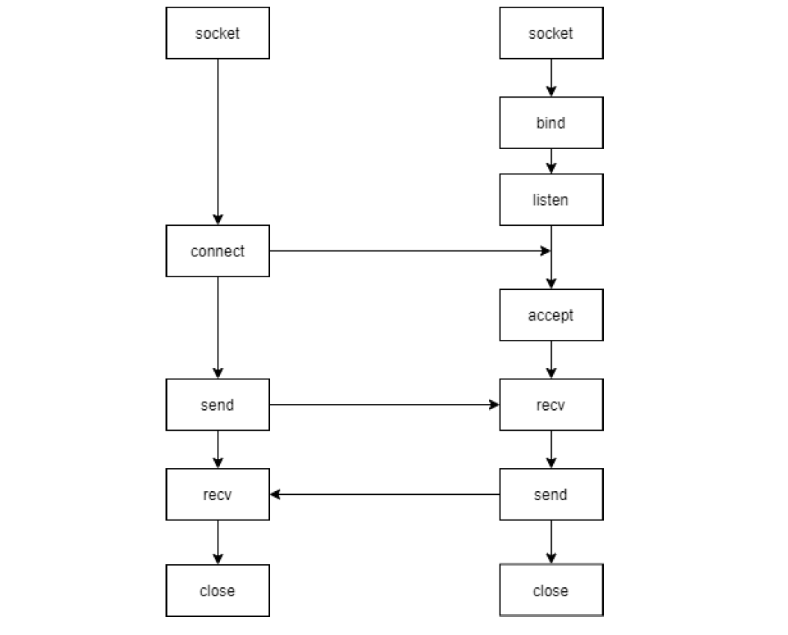

##### socket

`socket - create an endpoint for communication`

`#include <sys/socket.h>`

`int socket(int domain, int type, int protocol);`

```c
/* 现代 C（C99/C11/C17/C23）权威写法：安全、简洁、无 memset */
struct addrinfo hints = {
    .ai_family   = AF_UNSPEC,   // 显式指定 IPv4/IPv6 通用
    .ai_socktype = SOCK_STREAM, // 显式指定 TCP
};

struct addrinfo *res = NULL;

// 2. 自动解析 IP/域名 与 端口/服务名
int status = getaddrinfo("127.0.0.1", "8080", &hints, &res);

int fd = socket(res->ai_family, res->ai_socktype, res->ai_protocol);
```


##### connect

`connect - initiate a connection on a socket`

`#include <sys/socket.h>`

`int connect(int sockfd, const struct sockaddr *addr, socklen_t addrlen);`

```c
connect(fd, res->ai_addr, res->ai_addrlen);
freeaddrinfo(res);
```


**Q1：如何区分两条不同的TCP连接？**

四元组 <源IP，源端口号，目的IP，目的端口号>，如果都一样，就是同一条连接。


##### **bind**

`bind - bind a name to a socket`

`#include <sys/socket.h>`

`int bind(int sockfd, const struct sockaddr *addr, socklen_t addrlen);`

绑定一个`ip:port`给socket


##### listen

`listen - listen for connections on a socket`

`#include <sys/socket.h>`

`int listen(int sockfd, int backlog);`

listen是清空socket的文件对象，建立了半连接队列和全连接队列。

listen是说明让socket当做服务端来使用。

backlog：半连接队列的长度


##### accept

`accept, accept4 - accept a connection on a socket`

`#include <sys/socket.h>`

`int accept(int sockfd, struct sockaddr *addr, socklen_t *addrlen);`

accept从全连接队列中取出一个连接，构建一个新的已连接socket。


##### send

`send, sendto, sendmsg - send a message on a socket`

`#include <sys/socket.h>`

`ssize_t send(int sockfd, void *buf, size_t len, int flags);`


##### recv

`recv, recvfrom, recvmsg - receive a message from a socket`

`#include <sys/socket.h>`

`ssize_t recv(int sockfd, void *buf, size_t len,int flags);`


#### **TCP样例**

服务端：

```c
#include <stdio.h>
#include <unistd.h>
#include <sys/socket.h>
#include <netdb.h>
#include <sys/select.h>
#include <unistd.h>
#include <string.h>

int main()
{
    // 1. 配置监听条件（AI_PASSIVE 表示服务端 bind 模式）
    struct addrinfo hints = {
                        .ai_family = AF_UNSPEC,     // IPv4 / IPv6 通用
                        .ai_socktype = SOCK_STREAM, // TCP
                        .ai_flags = AI_PASSIVE      // 自动填充 INADDR_ANY (0.0.0.0)
                    },
                    *res;

    // node 传 NULL，自动绑定 1234 端口
    getaddrinfo(NULL, "1234", &hints, &res);

    // 2. 创建 Socket
    int listen_fd = socket(res->ai_family, res->ai_socktype, res->ai_protocol);

    // 3. 设置端口复用（非常重要！防止重启服务端时报 Address already in use 错误）
    // 主动关闭方在4次挥手之后会进入TIME_WAIT状态，固定时间60s
    // 服务端在TIME_WAIT期间内，不允许bind同样的ip和端口
    // 这里可以让服务端无视TIME_WAIT
    int opt = 1;
    setsockopt(listen_fd, SOL_SOCKET, SO_REUSEADDR, &opt, sizeof(opt));

    // 4. 绑定端口并开始监听
    bind(listen_fd, res->ai_addr, res->ai_addrlen);
    freeaddrinfo(res); // 绑定完即可释放地址链表内存

    listen(listen_fd, 128); // 128 为半连接队列 backlog 大小
    printf("Server in listening on port 1234...\n");

    // 5. 阻塞等待并接受客户端连接
    int client_fd = accept(listen_fd, NULL, NULL);

    // 6. select同时监听标准输入和client_fd
    fd_set rdset;
    char buf[4096] = {0};
    while (1)
    {
        FD_ZERO(&rdset);
        FD_SET(STDIN_FILENO, &rdset);
        FD_SET(client_fd, &rdset);
        select(client_fd + 1, &rdset, NULL, NULL, NULL);
        if (FD_ISSET(STDIN_FILENO, &rdset))
        { // 如果标准输入就绪
            bzero(buf, sizeof(buf));
            read(STDIN_FILENO, buf, sizeof(buf));
            send(client_fd, buf, strlen(buf), 0);
        }
        if (FD_ISSET(client_fd, &rdset))
        { // 如果socket就绪
            bzero(buf, sizeof(buf));
            ssize_t ret = recv(client_fd, buf, sizeof(buf), 0);
            if (ret == 0)
            {
                printf("\npeer disconnected.\n");
                break;
            }
            else if (ret <= 0)
            {
                perror("recv error");
                break;
            }
            puts(buf);
        }
    }
    close(listen_fd);
    close(client_fd);
}
```

客户端：

```c
#include <stdio.h>
#include <sys/socket.h>
#include <netdb.h>
#include <stdlib.h>
#include <sys/select.h>
#include <unistd.h>
#include <string.h>

int main()
{
    struct addrinfo hints = {
        .ai_family = AF_UNSPEC,     // 显式指定 IPv4/IPv6 通用
        .ai_socktype = SOCK_STREAM, // 显式指定 TCP
    };
    struct addrinfo *res = NULL;
    int status = getaddrinfo("127.0.0.1", "1234", &hints, &res);

    // 1.创建socket
    int fd = socket(res->ai_family, res->ai_socktype, res->ai_protocol);

    // 2.connect建立连接
    if (connect(fd, res->ai_addr, res->ai_addrlen) == -1)
    {
        perror("connect error!");
        exit(1);
    }

    fd_set rdset;
    char buf[4096] = {0};
    while (1)
    {
        FD_ZERO(&rdset);
        FD_SET(STDIN_FILENO, &rdset);
        FD_SET(fd, &rdset);
        select(fd + 1, &rdset, NULL, NULL, NULL);
        if (FD_ISSET(STDIN_FILENO, &rdset))
        { // 如果标准输入就绪
            bzero(buf, sizeof(buf));
            read(STDIN_FILENO, buf, sizeof(buf));
            send(fd, buf, strlen(buf), 0);
        }
        if (FD_ISSET(fd, &rdset))
        { // 如果socket就绪
            bzero(buf, sizeof(buf));
            ssize_t ret = recv(fd, buf, sizeof(buf), 0);
            if (ret == 0)
            {
                printf("\npeer disconnected.\n");
                break;
            }
            else if (ret <= 0)
            {
                perror("recv error");
                break;
            }
            puts(buf);
        }
    }
    close(fd);
}

```


#### epoll

IO多路复用，高性能

1. 所有监听数据放在内核态，看成一个文件对象，避免了用户态到内核态的拷贝问题
2. 把监听和就绪分离，epoll文件对象里，维护一个监听集合，以及一个就绪事件队列(因此只需要轮询就绪队列)

