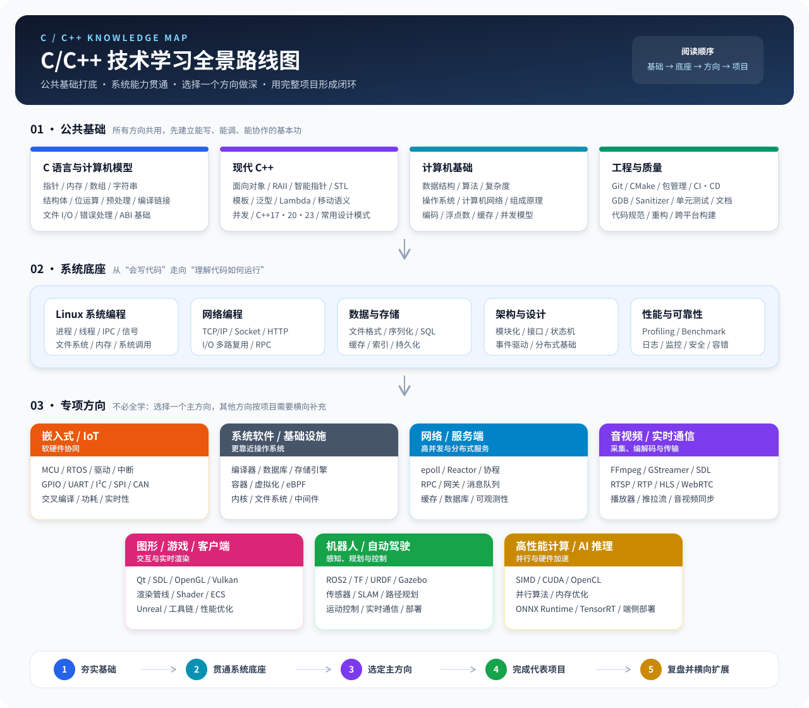
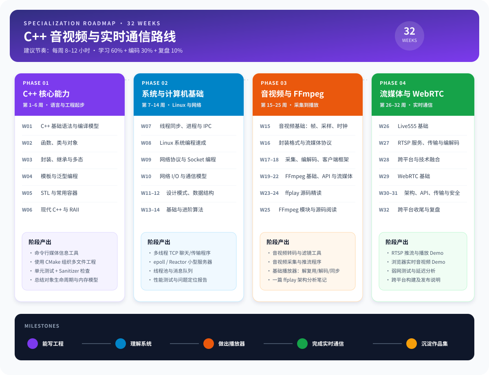
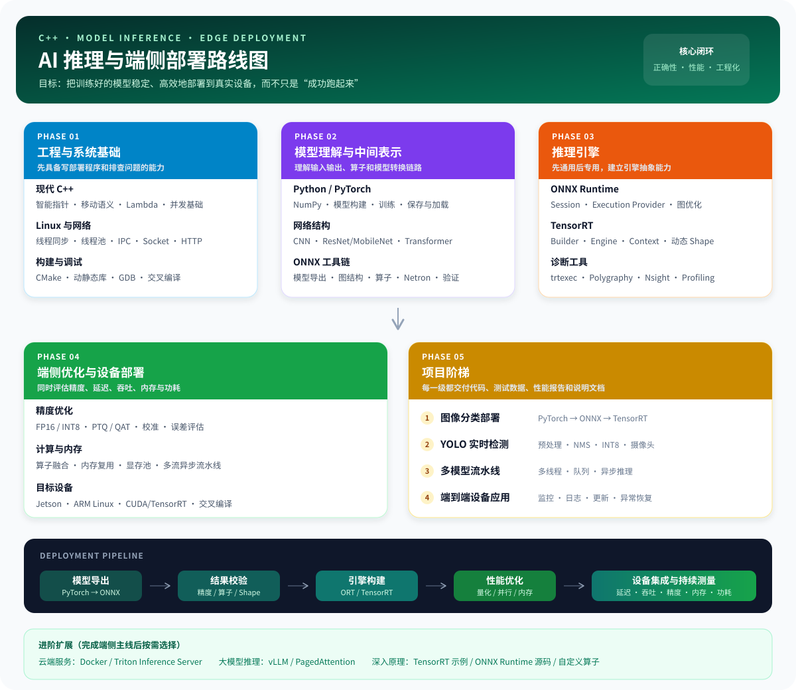

# C/C++ 技术路线图

> 这不是一张“全部学完才能开始”的清单。先完成公共基础和系统底座，再选择一个主方向深入；其他方向作为项目需要时的补充。

## 全景路线

### 怎么使用这张图

1. **公共基础**：优先掌握 C、现代 C++、数据结构与工程工具。
2. **系统底座**：通过 Linux、网络、存储与性能分析理解程序如何真正运行。
3. **专项方向**：只选一个主方向持续做项目，不按图中顺序横向扫完所有技术。
4. **项目闭环**：每个阶段至少留下代码、README、测试和一篇复盘笔记。

## 已收录方向

| 方向 | 当前内容 | 状态 |
| --- | --- | --- |
| 语言与基础 | [C](c.md) · [C++](cpp.md) · [数据结构](ds.md) | 持续整理 |
| Linux 系统编程 | [Linux 系统编程](linux.md) | 持续整理 |
| 机器人 / 自动驾驶 | [机器人技术栈](robot-tech-stack/0.outline.md) | 已建立专项路线 |
| 音视频 / 实时通信 | [32 周专项路线](#音视频与实时通信专项) | 路线已建立 |
| 嵌入式 / IoT | MCU、RTOS、驱动与总线协议 | 待收录 |
| 网络 / 服务端 | 高并发网络、RPC、数据库与中间件 | 待收录 |
| 图形 / 游戏 / 客户端 | Qt、OpenGL/Vulkan、渲染与引擎 | 待收录 |
| 高性能计算 / AI 推理 | [AI 推理与端侧部署路线](#ai-推理与端侧部署专项) | 路线已建立 |

---

## 音视频与实时通信专项

这张路线根据原来的 32 周表重新组织：不再只是逐周罗列知识点，而是给每一阶段增加一个可验证的项目产出。

### 四个阶段

- **第 1–6 周**：建立现代 C++ 与工程能力。
- **第 7–14 周**：补齐 Linux、网络、数据结构和算法基础。
- **第 15–25 周**：学习音视频基础与 FFmpeg，完成基础播放器。
- **第 26–32 周**：进入 RTSP、Live555 与 WebRTC，完成实时通信 Demo。

> 周数只是参考节奏。是否掌握应以阶段项目能否独立完成、能否说明关键设计取舍为准。

---

## AI 推理与端侧部署专项

这条路线聚焦 C++ 推理应用：从模型导出、结果校验、推理引擎构建和性能优化，一直到 Jetson 等边缘设备上的工程化部署。

### 五个阶段

- **工程与系统基础**：现代 C++、Linux 多线程、网络、CMake 与交叉编译。
- **模型理解与中间表示**：PyTorch、常见网络结构、ONNX 与 Netron。
- **推理引擎**：先掌握 ONNX Runtime，再深入 TensorRT 及其诊断工具。
- **端侧优化与设备部署**：量化、算子融合、内存优化、异步流水线和 Jetson 部署。
- **项目阶梯**：分类 → YOLO 检测 → 多模型流水线 → 端到端设备应用。

> Triton、vLLM 和源码精读被放到进阶扩展中；它们很有价值，但不是完成端侧部署主线的前置条件。

## 机器人专项

机器人方向保留为独立技术栈，包含 ROS2、Linux 系统编程、硬件接口、传感器和整机项目：

[进入机器人技术栈 →](robot-tech-stack/0.outline.md)
