# 机器人 / 自动驾驶技术栈

> 机器人是 C/C++ 专项方向之一。本路线聚焦 Linux + ROS2 + 硬件接口 + 整机项目，不再承担整个笔记站点的总目录角色。

## 当前实践环境

- **开发环境**：Ubuntu 24.04 · ROS2 Jazzy
- **硬件平台**：Raspberry Pi 5 + Yahboom Raspbot V2
- **项目范围**：麦轮底盘、I²C 驱动板、超声波/循迹、2DOF 云台、OLED/RGB/蜂鸣器

## 学习阶段

1. [C++ 核心强化](1.cpp.md)
2. [Linux 系统编程](2.linux.md)
3. [RaspBot 小车整机项目](3.RaspBot-Project.md)

[返回 C/C++ 总路线图 →](../roadmap.md)
